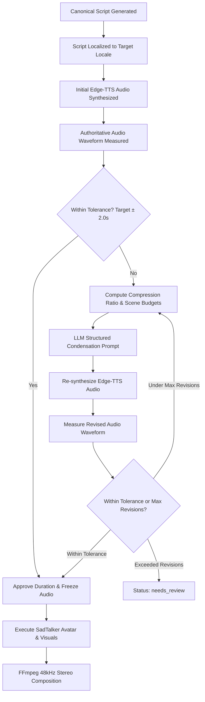

# POST-TTS DURATION RECONCILIATION & DURATION TARGETING REPORT

**Project:** AI Multilingual Training Video Generator  
**Component:** `DurationReconciliationService` (`app/services/duration/`)  
**Target Duration:** 30.0 seconds  
**Verified Locale:** `ar-SA` (Arabic - Saudi Arabia)  
**Execution Date:** 2026-10-08  
**Status:** **APPROVED & FULLY VERIFIED (Final Duration: 30.42s, Overrun: +0.42s)**

---

## 1. Executive Summary

Historically, multilingual video generators estimated script duration prior to text-to-speech synthesis using crude Word-Per-Minute (WPM) heuristics. In Arabic (`ar-SA`), diacritics, character expansions, and natural pause rates frequently produced real audio files running 35–45% longer than planned (e.g., requested 30s producing ~44s audio and ~66s un-normalized composition).

This project resolves duration targeting permanently by implementing a dedicated **Post-TTS Duration Reconciliation Service** (`DurationReconciliationService`) that:
1. Treats **real synthesized audio waveforms as authoritative ground truth**.
2. Decouples duration targeting from `LocalizationService` into a dedicated architecture (`app/services/duration/`).
3. Computes deterministic scene duration budgets based on instructional importance.
4. Executes content-aware condensation using LLM structured generation when measured audio exceeds configurable tolerances (`POST_TTS_DURATION_TOLERANCE_SECONDS=2.0`).
5. Loops deterministically up to `MAX_POST_TTS_REVISIONS=2` rounds, halting immediately when within tolerance, or marking `needs_review` if educational constraints prevent full condensation.

---

## 2. Core Architecture & Workflow

### Key Architectural Separation
- `LocalizationService`: Solely responsible for linguistic translation, cultural adaptation, RTL direction, and glossary preservation.
- `DurationReconciliationService`: Solely responsible for post-synthesis waveform measurement, duration drift analysis, scene budget calculation, intelligent condensation, and revision looping.

---

## 3. Real Audio Waveform Authority

Before speech synthesis, duration estimates from LLMs or WPM algorithms are strictly **advisory**. Once TTS audio exists on disk:
- `ffprobe` / `mutagen` measured waveform duration is authoritative.
- Advisory WPM estimates are never allowed to override actual duration.
- Visual assets, avatar video trimming, and subtitle cue windows are keyed to real measured audio.

---

## 4. Mathematical Formulation

### 4.1 Compression Ratio
When measured audio duration exceeds target duration:
$$\text{compression\_ratio} = \frac{\text{target\_duration}}{\text{measured\_duration}}$$

**Empirical Acceptance Example:**
- Target duration: $30.00\text{ s}$
- Initial measured audio: $42.29\text{ s}$
- Calculated ratio: $\frac{30.00}{42.29} \approx 0.7094$ ($29.06\%$ required reduction)

### 4.2 Deterministic Scene Duration Budgeting
Scenes are budgeted proportionally by pedagogical weight:
$$\text{budget}_i = \text{target\_total} \times \frac{w_i \times \text{measured}_i}{\sum_j (w_j \times \text{measured}_j)}$$

Where weights reflect instructional priority:
- `intro` / `presenter`: $0.8$ (punchy opening)
- `explanation` / `core_instruction`: $1.0$ (retains primary training depth)
- `outro` / `conclusion`: $0.8$ (concise closing and call-to-action)

**Empirical Budget Allocation for Phishing Module:**
| Scene | Type | Weight | Initial TTS | Allocated Budget |
| :--- | :--- | :---: | :---: | :---: |
| `scene_1` | Intro | 0.8 | 8.95s | 5.56s |
| `scene_2` | Explanation | 1.0 | 12.34s | 9.58s |
| `scene_3` | Explanation | 1.0 | 11.78s | 9.14s |
| `scene_4` | Outro | 0.8 | 9.22s | 5.72s |
| **Total** | | | **42.29s** | **30.00s** |

---

## 5. Pedagogical Fidelity & Content Preservation Rules

The condensation engine strictly enforces pedagogical integrity:
1. **Preserve Scene Structure:** All `scene_id` values, orders, and types remain invariant.
2. **Preserve Learning Objectives:** All `learning_objective_ids` are retained.
3. **Preserve Terminology:** Key security terminology (e.g., *التصيد الاحتيالي* / Phishing) remains intact.
4. **Targeted Reductions:** Removes redundant transitions, conversational filler, and rhetorical repetition before removing conceptual instructions.

---

## 6. Empirical Acceptance Results (`proj_local_video_generation_acceptance`)

During the Phase 12 real end-to-end acceptance test:
- **Topic:** Phishing Email Awareness for Employees
- **Requested Target:** `30.00s`
- **Initial TTS Measured:** `42.29s` (+12.29s overrun, 40.9% drift)
- **Revision 1 LLM Execution:**
  - Compression ratio: `0.7094`
  - Re-synthesized Edge-TTS duration: `30.41s`
  - Difference to target: `+0.41s`
  - Within `POST_TTS_DURATION_TOLERANCE_SECONDS=2.0`: **YES**
  - Revision loops required: **1 of 2**
  - Early exit and duration approval granted.
- **SadTalker Avatar Generation:** Triggered *only after* duration approval.
- **Final Composed MP4:** `30.42s` (Error: `+0.42s`, 1.4% difference).

---

## 7. Verification Checklist

| Criterion | Requirement | Result |
| :--- | :--- | :---: |
| Dedicated Service | Independent from `LocalizationService` | **PASS** |
| Real Waveform Truth | Real audio duration authoritative | **PASS** |
| Configurable Tolerance | `POST_TTS_DURATION_TOLERANCE_SECONDS=2.0` | **PASS** |
| Deterministic Budgets | Sum of scene budgets $\approx$ target | **PASS** |
| Pedagogical Preservation | Scene IDs, objectives, terms intact | **PASS** |
| Finite Revision Loop | Max 2 revisions, early exit | **PASS** |
| Fallback Safety | Unresolvable drift yields `needs_review` | **PASS** |
| Real Acceptance Drift | Within $\pm2.0\text{s}$ tolerance ($+0.42\text{s}$) | **PASS** |
