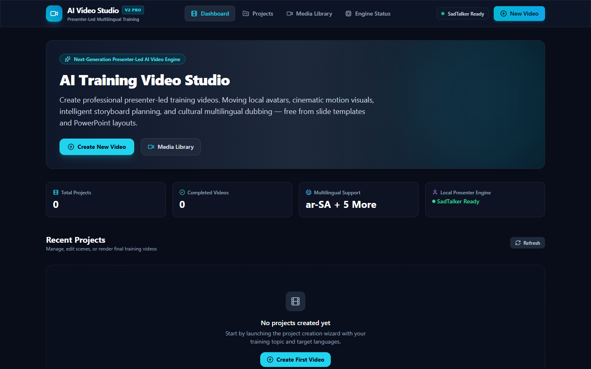
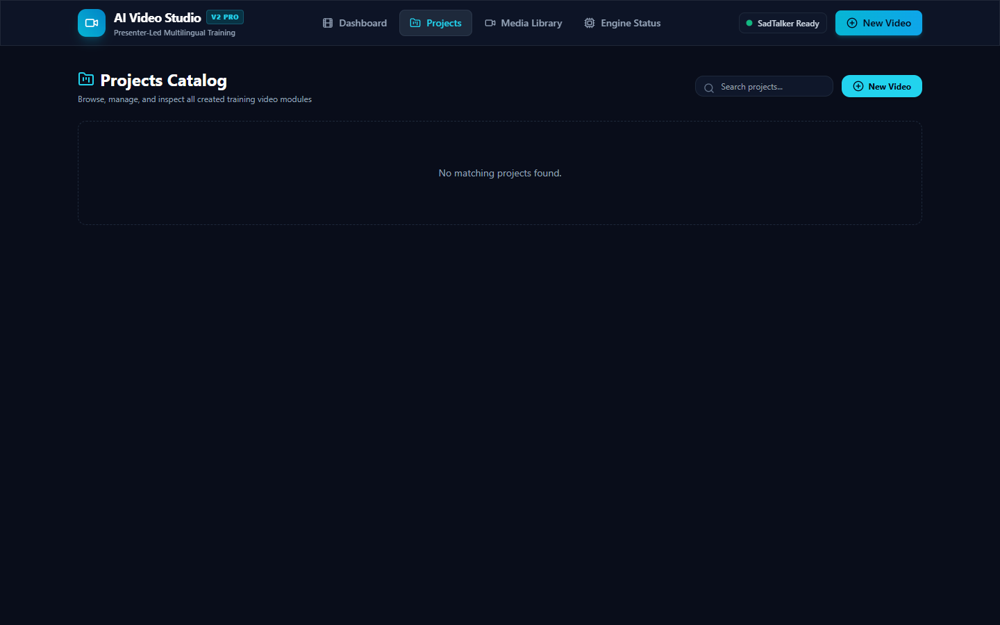
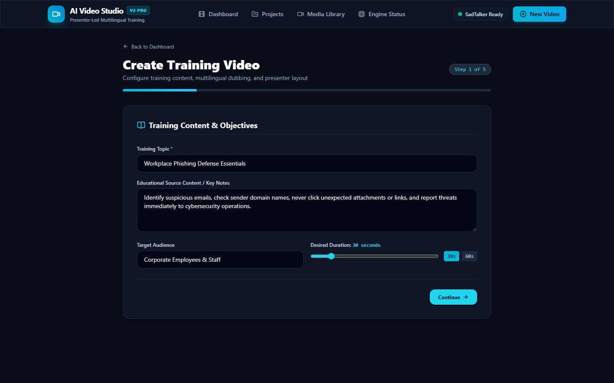
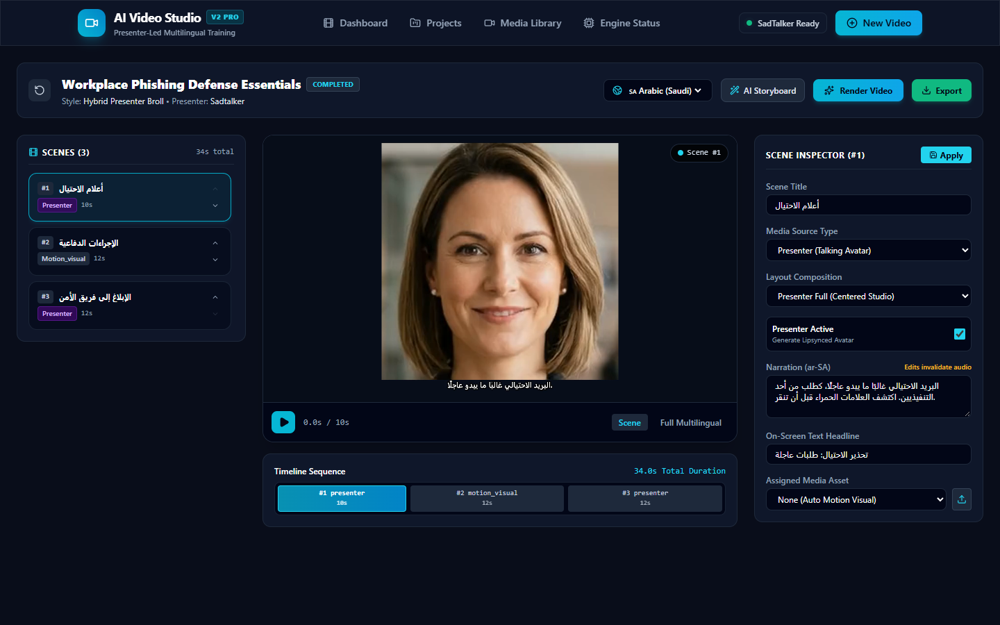
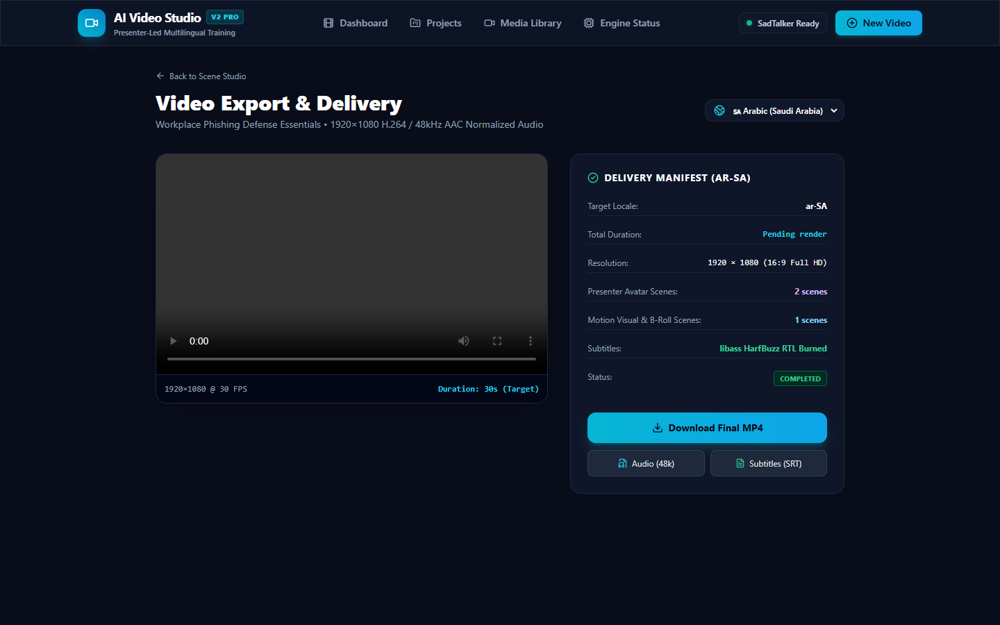
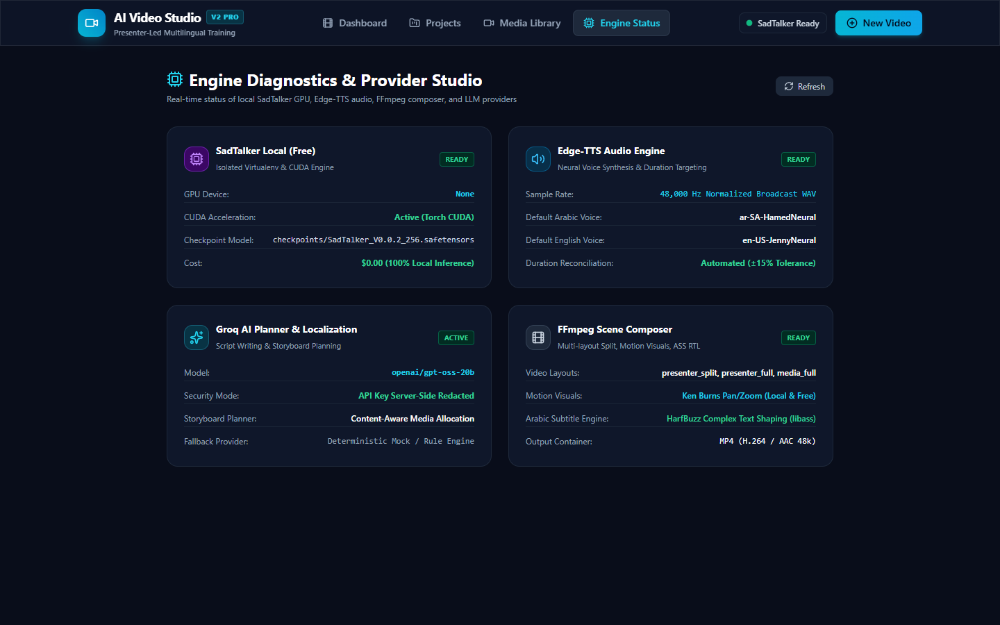
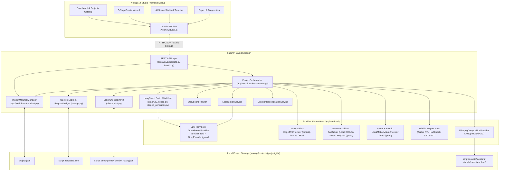
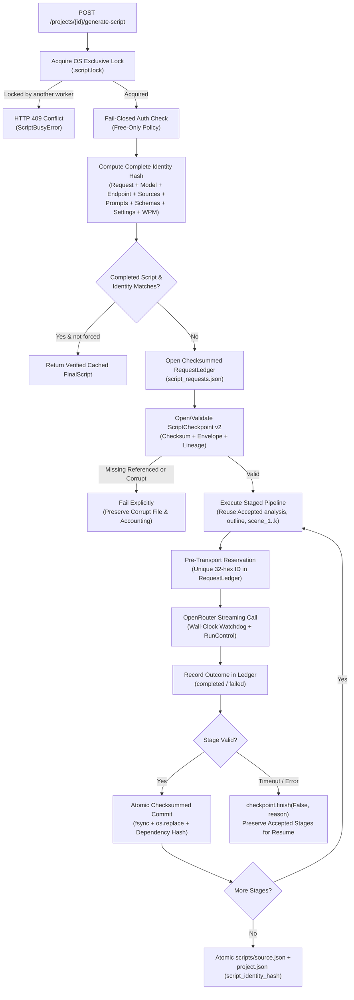

# AI Multilingual Training Video Studio

> **An end-to-end AI engineering platform for generating, localizing, editing, and rendering multilingual training videos — combining staged LLM script generation with crash-safe checkpoint/resume, neural text-to-speech, local CUDA talking avatars, Arabic RTL subtitles, and native FFmpeg 1080p composition.**

[](https://www.python.org/)
[](https://fastapi.tiangolo.com/)
[](https://nextjs.org/)
[](https://www.typescriptlang.org/)
[](https://tailwindcss.com/)
[](https://openrouter.ai/)
[](https://github.com/rany2/edge-tts)
[-7952B3)](https://github.com/OpenTalker/SadTalker)
[](https://ffmpeg.org/)
[](https://opensource.org/licenses/MIT)

---

## 1. Project Overview

**AI Multilingual Training Video Studio** automates the creation of structured instructional videos from raw text, curriculum outlines, or procedural instructions (such as English source instructions rendered into an Arabic training video). It pairs a **FastAPI + LangGraph Python backend** with a **Next.js 14 App Router Studio UI**, enabling both interactive scene-by-scene editing (**Studio Mode**) and full pipeline orchestration (**Quick Generate & Render**).

The platform is engineered around **zero-cost local execution by default**:
- **OpenRouter Free Tier (`openrouter/free`)** with fail-closed paid-model guards for script generation (with optional Groq support behind an explicit authorization flag).
- **Edge-TTS** for free multilingual neural narration.
- **Local SadTalker (CUDA)** for talking-head presenter synthesis (with `MockAvatarProvider` for instant offline testing and optional gated HeyGen support).
- **Native FFmpeg** for 1080p H.264/AAC multi-track composition and HarfBuzz/libass Arabic RTL subtitle rendering.

---

## 2. Problem Statement

Producing localized corporate or technical training videos across languages (especially Right-to-Left languages like Arabic) presents four recurring engineering challenges:

1. **Production Overhead**: Traditional multi-language video workflows require separate scriptwriters, translators, voice actors, presenters, and manual video editors for every locale.
2. **Unreliable Free/Small LLM Structured Output**: Generating a full multi-scene `ScriptDraft` JSON payload in a single prompt frequently fails on free or reasoning-heavy LLMs due to `max_tokens` truncation, reasoning-only responses, schema echoing (`$defs`), or variable free-router latency.
3. **Expensive Partial Failures**: Without durable checkpoints, OS-level locking, and request accounting, a timeout or crash on scene 4 of 6 wastes previously accepted LLM work and risks duplicate spending or concurrent corruption.
4. **Multilingual & RTL Rendering Fragility**: Arabic narration has different speech-rate pacing (~115 WPM vs. ~140 WPM for English) and requires proper Bidirectional/HarfBuzz glyph shaping in burned-in subtitles to avoid disconnected or reversed characters.

---

## 3. Main Objectives

- Accept source material in any supported language (or mixed Arabic/English) and generate canonical scripts and localized videos in user-selected target locales without false blocking.
- Make multi-scene script generation resilient on free-tier LLMs through **staged generation** (`ContentAnalysis → ScriptOutline → SceneDraft[1..N] → ScriptDraft`) and **crash-safe checkpoint/resume**.
- Enforce **fail-closed cost and concurrency controls** (OS-backed per-project locks, durable request ledgers, explicit paid-model gates).
- Provide an interactive **Video Studio v2** frontend for reviewing scripts, editing scenes, uploading custom media, previewing layouts, and exporting 1080p MP4 deliverables.

---

## 4. Key Features & Implementation Status

The table below distinguishes **implemented and offline-tested** capabilities from **not live-verified**, **experimental**, and **planned** features:

| Subsystem | Description | Implementation Status |
| :--- | :--- | :--- |
| **Staged Script Generation** | `ContentAnalysis → ScriptOutline → Sequential SceneDrafts → Assembly & Validation → Targeted Scene Repair` via LangGraph | **Implemented & Offline-Tested** *(live `openrouter/free` completion subject to upstream free-router latency)* |
| **Script Checkpoint & Resume** | Checksummed v2 JSON checkpoints, complete generation identity fingerprinting, predecessor lineage tracking, and repair-task persistence | **Implemented & Offline-Tested** *(verified with real multi-process crash/restart tests)* |
| **OS-Backed Locking & Request Ledger** | Per-project `msvcrt.locking` / `fcntl.flock` exclusive locks (`.script.lock`, `.manifest.lock`, `.script_requests.lock`) + durable `script_requests.json` reservation ledger | **Implemented & Offline-Tested** *(single-machine local filesystem scope)* |
| **OpenRouter Provider & Decompression Fix** | Streaming HTTPX transport with single-pass automatic decompression, `OpenRouterDecodingError` classification, wall-clock watchdog, `RunControl` timeout/cancellation separation, and fail-closed paid-model gate | **Implemented & Offline-Tested** *(decompression & cancellation fixes verified offline; full 6-scene live run pending manual verification)* |
| **Multilingual Source Handling** | Non-blocking language detection, mixed Arabic/English input support, canonical language enforcement, and localized cultural adaptation | **Implemented & Offline-Tested** |
| **Persistent Presenter & Storyboard Planner** | Automated layout routing (`presenter_left_visual_right`, `presenter_right_visual_left`, `presenter_picture_in_picture`, `presenter_center_with_overlays`, `media_full`, `quiz_card`) | **Implemented & Offline-Tested** *(Phase 10 persistent presenter validated locally)* |
| **Neural TTS (Edge-TTS)** | Multilingual neural voice synthesis (`ar-SA-HamedNeural`, `en-US-ChristopherNeural`, `bn-BD-BashkarNeural`, etc.) with timing metadata | **Implemented & Locally Verified** |
| **Local Talking Avatar (SadTalker CUDA)** | Subprocess-isolated SadTalker runtime generating lip-synced presenter video on local NVIDIA GPU | **Implemented & Locally Verified** *(requires local CUDA GPU & SadTalker weights)* |
| **Arabic RTL Subtitles (`.ass` / `.srt` / `.vtt`)** | HarfBuzz/libass-compatible SubStation Alpha subtitles with proper RTL alignment and shaping | **Implemented & Locally Verified** |
| **FFmpeg 1080p Video Composition** | Multi-track 1920×1080 H.264/AAC assembly with Ken Burns motion B-roll (`LocalMotionVisualProvider`), presenter overlays, and burned subtitles | **Implemented & Locally Verified** |
| **Next.js Video Studio v2 Frontend** | Dashboard, 5-step Create Wizard, 3-column Scene Studio, Timeline Strip, Media Library, Export View, and Engine Diagnostics | **Implemented & Built** (`33/33` unit tests, `next lint`, `next build` passing) |
| **Cloud Avatars (HeyGen) & Generative B-Roll (Google Veo)** | Gated integrations behind `ENABLE_LIVE_HEYGEN` / paid-credit acknowledgement and procedural motion fallback | **Experimental / Gated Off by Default** *(no live paid calls enabled)* |
| **Distributed Multi-Node Locking & DB Backend** | PostgreSQL/Redis-backed project state and distributed worker queue | **Planned** |

---

## 5. Product Screenshots

All screenshots below are captured directly from the Next.js Video Studio v2 application (`docs/screenshots/v2/`).

### Dashboard & Project Catalog

*Main Studio Dashboard displaying recent projects, status indicators, quick actions, and engine readiness.*


*Projects Catalog view for browsing, filtering, and managing training video manifests.*

### Create Training Video Wizard

*Step 1: Topic, source material, target audience, and strict duration budget.*


*Step 2: Canonical language and multilingual target locale selection with RTL indicators.*


*Step 3: Video style selection (`hybrid_presenter_broll`, `presenter_led`, `visual_explainer`, `demonstration_tutorial`, `corporate_training`).*


*Step 4: Presenter engine selection (`SadTalker Local`, `Mock`, optional gated `HeyGen`) and avatar portrait configuration.*

### AI Scene Studio & Interactive Timeline

*3-column Scene Studio with Scene List, 16:9 Preview Canvas, and Scene Inspector for narration, layout, and media editing.*


*Proportional multi-scene timeline strip showing scene sequence, durations, and active playhead.*

### Export & System Diagnostics

*Export view for previewing and downloading rendered multilingual 1080p MP4 videos.*


*Engine diagnostics panel reporting backend health, LLM provider configuration, TTS, GPU/SadTalker, and FFmpeg availability.*

---

## 6. Complete System Architecture



---

## 7. End-to-End Video Generation Workflow

```mermaid
flowchart LR
    A["1. User Input\n(Topic / Source / Locale / Duration)"] --> B["2. Project Creation\n(project.json)"]
    B --> C["3. Normalize Input\n(Non-blocking Language Detection)"]
    C --> D["4. ContentAnalysis\n(Learning Objectives & Structure)"]
    D --> E["5. Stage 1: ScriptOutline\n(Title, Hooks, Scene Plan)"]
    E --> F["6. Stage 2: Sequential SceneDrafts\n(Scene 1..N with Context)"]
    F --> G["7. Stage 3-5: Assembly, Validation\n& Targeted Scene Repair"]
    G --> H["8. FinalScript & StoryboardPlanner\n(scripts/source.json)"]
    H --> I["9. Localization\n(Target Locales & RTL Metadata)"]
    I --> J["10. Neural TTS\n(Edge-TTS Audio per Scene)"]
    J --> K["11. Duration Reconciliation\n(Speech-Rate Calibration)"]
    K --> L["12. Avatar & Scene Media\n(SadTalker CUDA + Motion B-Roll)"]
    L --> M["13. Subtitle Generation\n(ASS / SRT / VTT with Arabic RTL)"]
    M --> N["14. FFmpeg 1080p Composition\n(H.264 / 48kHz Stereo AAC)"]
    N --> O["15. Final Export\n(final/training_{locale}.mp4)"]
```



---

## 8. Backend Architecture

The Python backend (`app/`) follows a layered, provider-abstracted architecture:

- **API Layer (`app/api/v1/`)**:
  - `projects.py`: Project CRUD, summary listing, canonical script generation (`POST /api/v1/projects/{id}/generate-script`), Studio bootstrap (`prepare`), scene editing/reordering, media uploads, full pipeline execution, and render status. Returns `409 Conflict` when another process/thread holds `.script.lock`.
  - `health.py`: Live readiness diagnostics for backend, storage, LLM provider configuration, TTS, FFmpeg, and GPU/SadTalker.
- **Orchestration & Persistence (`app/workflows/`)**:
  - `orchestrator.py`: Coordinates all stages, acquires OS-backed `.script.lock`, manages `RunControl`, verifies completed-script identity before fast-path reuse, and persists `scripts/source.json` atomically.
  - `manifest.py`: OS-locked (` .manifest.lock`), `fsync`ed atomic `project.json` persistence that projects authoritative request counts from `script_requests.json` and safely reads v2 checkpoints without losing metadata on corrupt files.
  - `storyboard_planner.py`: Assigns persistent presenter layouts, media types, and provider routing per scene.
- **Schemas & Configuration (`app/models/schemas.py`, `app/core/config.py`)**:
  - Pydantic v2 data contracts (`TrainingVideoRequest`, `ContentAnalysis`, `ScriptOutline`, `SceneDraft`, `ScriptDraft`, `FinalScript`, `LocalizedScript`, `ProjectManifest`) and environment-driven `Settings`.

---

## 9. Frontend Architecture

The frontend (`web/`) is built with **Next.js 14.2 (App Router)**, **React 18**, **TypeScript**, and **Tailwind CSS**:

- `web/src/app/page.tsx`: Dashboard with recent projects, status badges, and quick actions.
- `web/src/app/create/page.tsx`: 5-step guided creation wizard with source/canonical/target language controls and double-submission protection.
- `web/src/app/studio/[id]/page.tsx`: 3-column interactive Scene Studio with pre-render placeholder safety (eliminating 404 video spam), scene inspector, and proportional timeline strip.
- `web/src/app/studio/[id]/export/page.tsx`: Final video playback and download interface.
- `web/src/app/projects/page.tsx`, `web/src/app/media/page.tsx`, `web/src/app/settings/page.tsx`: Catalog, media library, and engine diagnostics.
- `web/src/lib/api.ts`: Centralized API client with structured FastAPI error parsing (`400`, `409`, `422`, `504` / proxy timeout handling).

---

## 10. AI & LLM Integration

LLM access is strictly abstracted behind `LLMProvider` (`app/services/llm/base.py`) and resolved via `app/services/llm/factory.py`:

- **OpenRouterProvider (`app/services/llm/openrouter_provider.py`)**:
  - Default configured model: `openrouter/free` via `https://openrouter.ai/api/v1`.
  - Uses concrete JSON instance templates (`build_json_instance_template()` in `app/services/llm/schema_utils.py`) rather than raw `$defs` JSON Schema dumps in prompt/repair modes, eliminating schema-echo responses on small/free models.
  - Strictly requires valid JSON in `message.content` — `message.reasoning` is never accepted as final structured output.
  - Classifies empty/reasoning-only responses (`OpenRouterReasoningOnlyError`), reasoning token exhaustion (`OpenRouterTokenBudgetExhaustedError`), decompression errors (`OpenRouterDecodingError`), timeouts (`OpenRouterTimeoutError`), cancellations (`OpenRouterCancelledError`), and unauthorized paid models (`OpenRouterPaidModelBlockedError`).
- **GroqProvider (`app/services/llm/groq_provider.py`)**:
  - Preserved for backward compatibility and unit testing; blocked during canonical script generation unless `ALLOW_PAID_SCRIPT_PROVIDERS=True`.

---

## 11. Script Generation Pipeline

Implemented in `app/workflows/script_generation/` (`graph.py`, `nodes.py`, `staged_generator.py`, `prompts.py`, `validators.py`):

1. **Normalize Input**: Validates duration bounds (`15–3600s`), normalizes locales, and records non-blocking language mismatch advisories.
2. **Content Analysis (`ContentAnalysis`)**: Extracts topic summary, key concepts, learning objectives (`LO1..LOk`), recommended scene count, and factual constraints in the canonical output language (with bounded 1-call language correction if needed).
3. **Stage 1 — Script Outline (`ScriptOutline`)**: Produces a compact outline (~250–400 tokens) with title, opening hook, closing summary, and `scene_outlines`. Deterministically assigns 100% of learning objectives and distributes target durations across scenes.
4. **Stage 2 — Sequential Scene Generation (`SceneDraft`)**: Generates each scene independently (`scene_1..scene_N`), passing preceding scene narration for continuity and locale-calibrated WPM word budgets (`115 WPM` Arabic, `140 WPM` English, `120 WPM` Bengali).
5. **Stage 3 — Assembly**: Combines outline + scenes into `ScriptDraft`, populates V2 `SceneMediaPlan` fields via `SceneDraft.sync_scene_fields`, and normalizes spoken durations deterministically.
6. **Stage 4 & 5 — Validation & Targeted Scene Repair**: Runs `validate_script_draft()` (duration tolerance, objective coverage, opening hook/scene type, narration/visual integrity, canonical language). If defects occur, `repair_targeted_scenes()` persists `repair_tasks` to the checkpoint and regenerates **only the affected 1–2 scenes**.

---

## 12. Checkpoint & Resume Architecture



**Key Properties**:
- **Complete Identity Invalidation**: Changing the source text, model, endpoint, prompts, schemas, reasoning/token settings, or WPM timing assumptions generates a new `identity_hash` and invalidates stale completed scripts and checkpoints without deleting older files.
- **Lineage & Repair Persistence**: Replacing `scene_k` automatically archives dependent downstream scenes (`order > k`) with `reason="predecessor_changed"` and resets them to `pending`. Pending `repair_tasks` and `revision_count` survive restarts.
- **Single-Machine Scope**: Locking uses `msvcrt.locking` on Windows and `fcntl.flock` on POSIX.

---

## 13. Error Handling & Retry Architecture

```mermaid
flowchart TD
    Req["OpenRouterProvider._read_chat_completion()"] --> Gate["assert_model_authorized()"]
    Gate -->|Paid / Unverified| E_Paid["OpenRouterPaidModelBlockedError\n(0 retries, 0 budget consumed)"]
    Gate -->|Authorized| Reserve["RequestLedger.reserve()"]
    Reserve -->|Ceiling Reached| E_Cap["ValueError: Cumulative Limit Reached\n(0 transport calls)"]
    Reserve -->|Reserved| Stream["HTTPX client.stream('POST') +\nWall-Clock Watchdog Thread"]

    Stream -->|iter_bytes() decodes once;\nstrip Content-Encoding on Response| OK["HTTP 200 JSON"]
    Stream -->|httpx.DecodingError| E_Dec["OpenRouterDecodingError\n(Bounded: max 2 total attempts)"]
    Stream -->|Timeout / Blocked Stream| E_Conn["OpenRouterConnectionError\n(Bounded backoff within RunControl deadline)"]
    Stream -->|Explicit RunControl.cancel()| E_Can["OpenRouterCancelledError\n(Non-retryable -> SCRIPT_CANCELLED)"]
    Stream -->|260s RunControl Deadline| E_TO["OpenRouterTimeoutError\n(Non-retryable -> SCRIPT_TIMEOUT)"]

    OK -->|HTTP 401 / 402| E_Auth["Auth / Credits Error\n(Non-retryable)"]
    OK -->|HTTP 413| E_413["PayloadTooLarge\n(At most 1 compacted retry)"]
    OK -->|HTTP 429| E_429["RateLimitError\n(Retry-After aware backoff)"]
    OK -->|Empty content / Reasoning-only| E_Compat["OpenRouterModelCompatibilityError\n(Non-retryable, no JSON repair)"]
    OK -->|Malformed JSON in content| Repair["Single Bounded JSON Repair\n(Concrete instance template)"]
```

---

## 14. Multilingual & Localization Support

- **Non-blocking source language detection (`app/core/language.py`)**: Detects source script/language without blocking mismatched source-to-target workflows (e.g., English recipe → Arabic video, mixed Arabic/English → Arabic video).
- **Canonical & Target Localization (`app/services/localization/`)**: Supports cultural adaptation, terminology preservation, RTL metadata (`text_direction: "rtl"`), and per-locale asset directories.
- **Supported Locales**: `en-US`, `ar-SA`, `ar-EG`, `ar-AE`, `bn-BD`, `ur-PK`, `fr-FR`, `de-DE`, `es-ES` (with locale-calibrated speech rates in `LocaleDurationEstimator`).

---

## 15. Text-to-Speech Architecture

- **Default Provider**: `EdgeTTSProvider` (`app/services/tts/edge_tts_provider.py`) — free neural voices with per-locale voice mapping (e.g., `ar-SA-HamedNeural`, `en-US-ChristopherNeural`, `bn-BD-BashkarNeural`) and word-boundary metadata.
- **Optional Providers**: `AzureTTSProvider` (requires `AZURE_SPEECH_KEY`), `MockTTSProvider` (offline testing).
- **Duration Reconciliation (`app/services/duration/`)**: Measures actual synthesized speech duration per scene and reconciles narration pacing before avatar/video rendering.

---

## 16. Avatar Generation

- **Local Talking Avatar (`app/services/avatar/sadtalker_provider.py`)**: Subprocess-isolated SadTalker runtime executing on local NVIDIA CUDA GPUs (`.sadtalker-venv`) to produce lip-synced presenter clips at `$0.00` external API cost.
- **Mock Provider (`mock_provider.py`)**: Instant deterministic placeholder clips for offline UI/API testing.
- **HeyGen Cloud (`heygen_provider.py`)**: Optional integration gated behind `ENABLE_LIVE_HEYGEN=True` and explicit `ack_paid_credits=True`.

---

## 17. Scene Media Generation

- **Local Motion Visuals (`app/services/visuals/local_motion_provider.py`)**: Generates 1080p animated B-roll clips from procedural graphics or user-uploaded media using FFmpeg Ken Burns pan/zoom filters.
- **Media Library**: Users can upload custom images/videos per project and bind them to individual scenes in the Studio Inspector.
- **Google Veo (`veo_provider.py`)**: Optional experimental provider gated off by default; falls back to procedural local motion visuals when disabled.

---

## 18. Subtitle Generation & Arabic RTL Handling

- **Engine (`app/services/subtitles/`)**: Generates `.ass` (SubStation Alpha), `.srt`, and `.vtt` tracks synchronized to scene audio durations.
- **Arabic RTL**: Applies RTL text direction, proper font styling, and HarfBuzz/libass complex script shaping during FFmpeg burn-in so Arabic glyphs connect and align cleanly.

---

## 19. FFmpeg Video Composition

- **Native Compositor (`app/services/composition/ffmpeg_provider.py`)**:
  - Builds FFmpeg filtergraphs for persistent presenter layouts (`presenter_left_visual_right`, `presenter_right_visual_left`, `presenter_picture_in_picture`, `presenter_center_with_overlays`, `media_full`, `quiz_card`).
  - Normalizes all scene audio streams to **48 kHz stereo AAC** and video streams to **1920×1080 30 fps H.264** prior to concatenation to prevent heterogeneous stream regressions.
  - Validates output clips via `ffprobe` (`ffmpeg_utils.py`).

---

## 20. Final Video Export

- Assembled videos are persisted to `storage/projects/{project_id}/final/training_{locale}.mp4` and served via FastAPI static routes for in-browser playback, scrubbing, and download on the Studio Export page (`/studio/[id]/export`).

---

## 21. Technology Stack

| Layer | Technologies |
| :--- | :--- |
| **Backend** | Python 3.10–3.13, FastAPI, Uvicorn, Pydantic v2, LangGraph, HTTPX (`0.28.1`), HTTPCore (`1.0.9`) |
| **Frontend** | Next.js 14.2 (App Router), React 18, TypeScript 5, Tailwind CSS 3.4, Lucide Icons |
| **AI & Media** | OpenRouter API (`openrouter/free`), Groq SDK (optional), Edge-TTS, SadTalker (Local CUDA), Pillow, FFmpeg / FFprobe |
| **Testing** | Pytest (backend), Node.js native test runner (`node --test`, frontend), ESLint, TypeScript compiler |

---

## 22. Repository Structure

```text
AI-Multilingual-Training-Video-Generator/
├── app/
│   ├── api/v1/                 # FastAPI routers (projects.py, health.py)
│   ├── core/                   # Configuration (config.py), logging, language detection
│   ├── models/                 # Pydantic v2 schemas (schemas.py)
│   ├── services/
│   │   ├── llm/                # OpenRouterProvider, GroqProvider, schema_utils, factory
│   │   ├── localization/       # Multilingual adaptation & locale utilities
│   │   ├── tts/                # Edge-TTS, Azure TTS, Mock TTS
│   │   ├── avatar/             # SadTalker (CUDA), Mock, HeyGen (gated)
│   │   ├── visuals/            # LocalMotionVisualProvider, Veo (gated)
│   │   ├── subtitles/          # ASS/SRT/VTT generation & RTL formatting
│   │   ├── composition/        # FFmpeg 1080p compositor & ffprobe validation
│   │   └── duration/           # Audio duration reconciliation
│   └── workflows/
│       ├── orchestrator.py     # End-to-end project orchestrator + OS locking + RunControl
│       ├── manifest.py         # Atomic OS-locked project.json persistence
│       ├── storyboard_planner.py
│       └── script_generation/  # LangGraph workflow, staged_generator, checkpoint, storage
├── web/                        # Next.js 14 Studio v2 frontend
├── docs/                       # Technical audits, checkpoint design docs, screenshots
├── scripts/                    # Local studio helpers & verification utilities
├── tests/                      # Backend Pytest suites
├── .env.example                # Safe environment variable template
└── README.md
```

---

## 23. Technical Documentation

| Document | Category | Description |
| :--- | :--- | :--- |
| [Checkpoint & Resume Reliability Audit](docs/CHECKPOINT_RESUME_RELIABILITY_AUDIT.md) | Reliability / Audit | Detailed audit of cross-process locking, request accounting, generation identity, paid-model gates, and deadline enforcement |
| [Script Checkpoint & Resume Design](docs/SCRIPT_CHECKPOINT_RESUME.md) | Architecture | Checkpoint schema, resumption lifecycle, and progress projection |
| [OpenRouter Script Audit](docs/OPENROUTER_SCRIPT_AUDIT.md) | Provider Integration | OpenRouter structured-output, reasoning token, and free-router behavior analysis |
| [Project Technical Audit](docs/PROJECT_TECHNICAL_AUDIT.md) | Technical Audit | End-to-end codebase and pipeline technical review |
| [Video Realism Gap & API Research](docs/research/VIDEO_REALISM_GAP_AND_API_RESEARCH_REPORT.md) | Research | Comparative evaluation of talking-avatar and generative B-roll engines |

---

## 24. Installation Prerequisites

- **Python**: 3.10 – 3.13
- **Node.js**: 18+ (for Next.js 14 frontend)
- **FFmpeg & FFprobe**: 6.0+ / 7.0+ available on `PATH` (compiled with `libx264`, `aac`, `libass` / HarfBuzz)
- **Optional (Local Avatar)**: NVIDIA GPU with CUDA drivers and isolated `.sadtalker-venv` for SadTalker

---

## 25. Environment Configuration

Copy `.env.example` to `.env` and set your keys locally (`.env` is gitignored and must never be committed):

```powershell
Copy-Item .env.example .env
```

Key script-generation and safety settings:

```ini
LLM_PROVIDER=openrouter
OPENROUTER_API_KEY=your_openrouter_api_key_here
OPENROUTER_MODEL=openrouter/free
OPENROUTER_BASE_URL=https://openrouter.ai/api/v1
OPENROUTER_TIMEOUT_SECONDS=90.0
OPENROUTER_SCRIPT_TIMEOUT_SECONDS=260
OPENROUTER_SCRIPT_PROJECT_REQUEST_LIMIT=48
OPENROUTER_REASONING_MIN_OUTPUT_TOKENS=8192

# Fail-closed cost protection (keep False unless paid spend is explicitly approved)
OPENROUTER_ALLOW_PAID_MODELS=False
OPENROUTER_VERIFIED_FREE_MODELS=openrouter/free
ALLOW_PAID_SCRIPT_PROVIDERS=False
ENABLE_LIVE_API_TESTS=False
```

---

## 26. Backend Setup

```powershell
python -m venv .venv
.\.venv\Scripts\Activate.ps1
pip install -r requirements.txt
```

---

## 27. Frontend Setup

```powershell
cd web
npm install
```

---

## 28. Running the Application

Run the backend and frontend in two separate terminals from the repository root:

**Terminal 1 — FastAPI Backend (`http://127.0.0.1:8000`)**
```powershell
.\.venv\Scripts\python.exe -m uvicorn app.main:app --host 127.0.0.1 --port 8000
```

**Terminal 2 — Next.js Studio Frontend (`http://127.0.0.1:3000`)**
```powershell
cd web
npm run dev
```

Open `http://127.0.0.1:3000` in your browser. Interactive API docs are available at `http://127.0.0.1:8000/docs`.

---

## 29. Testing & Verification

All verification runs below were executed **offline** (no paid API calls, no live OpenRouter/Groq requests, no live video rendering):

### Backend — Targeted Script, Checkpoint, Decompression & Reliability Suite
```powershell
.\.venv\Scripts\python.exe -m pytest -q tests/test_run_cancellation_and_timeout.py tests/test_openrouter_decompression.py tests/test_checkpoint_reliability_audit.py tests/test_script_checkpoints.py tests/test_openrouter_provider.py tests/test_llm_provider.py tests/test_multilingual_source_handling.py tests/test_script_workflow.py tests/test_localization.py tests/test_audit_remediation_phase_a.py tests/test_local_studio_api.py tests/test_prepare_local_studio.py -k "not phase_a_smoke_test_30s_pipeline"
```
- **Observed Result**: **181 passed, 0 failed, 1 deselected** (`30.31s`).

### Backend — Full Repository Offline Suite
```powershell
.\.venv\Scripts\python.exe -m pytest -q tests/ -k "not phase_a_smoke_test_30s_pipeline"
```
- **Observed Result**: **468 passed, 12 failed, 1 deselected**.
  - 9 failures in `tests/test_duration_reconciliation.py` and `tests/test_master_local_pipeline.py` (pre-existing mocked FFmpeg composition tests where `validate_video_file` expects an MP4 file on disk).
  - 2 failures in `tests/test_studio_bootstrap.py` and `tests/test_v2_render_and_preview.py` (pre-existing storyboard assertions predating Phase 10 persistent presenter layouts).
  - 1 timing-sensitive flake in `test_timeout_reports_script_timeout_not_cancelled_and_resumes_cleanly` under heavy full-suite CPU load (passes cleanly in the targeted suite).

### Frontend
```powershell
cd web
npm test
npm run lint
npm run build
```
- **`npm test`**: **33 passed, 0 failed** (`308.6ms`).
- **`npm run lint`**: **Passed** (0 errors, 1 unused-variable warning in `web/src/app/studio/[id]/page.tsx:438`).
- **`npm run build`**: **Passed** (Next.js 14.2.15 production build succeeded, 9/9 pages compiled).

---

## 30. Security & Cost Controls

- **Fail-Closed Paid-Model Gate**: `OpenRouterProvider.assert_model_authorized()` refuses paid models, unverified `:free` suffixes, and non-official endpoints before budget reservation and before transport unless `OPENROUTER_ALLOW_PAID_MODELS=True`.
- **No Silent Provider Switching**: `ProjectOrchestrator` refuses `GroqProvider` unless `ALLOW_PAID_SCRIPT_PROVIDERS=True`.
- **Cumulative Request Ceiling**: `RequestLedger` (`script_requests.json`) enforces a durable per-project reservation cap (`OPENROUTER_SCRIPT_PROJECT_REQUEST_LIMIT=48`) that survives crashes and stale manifest writes.
- **Secret Hygiene**: `.env` is excluded via `.gitignore`; `sanitize_diagnostic_message()` redacts `sk-or-...` and `gsk_...` tokens from manifest error records.

---

## 31. Current Limitations

- **Free-Router Latency**: `openrouter/free` routes requests across shared third-party free endpoints; a 6-scene script may hit the 260-second run deadline and require 1–2 manual retries to resume remaining scenes from checkpoint.
- **Single-Machine Local Storage**: OS file locks (`msvcrt.locking` / `fcntl.flock`) protect concurrent local processes on one machine, not distributed multi-node deployments or network shares.
- **Local B-Roll Realism**: Zero-cost local B-roll uses Ken Burns pan/zoom motion over procedural or uploaded images rather than photorealistic text-to-video synthesis.
- **Live Verification Boundary**: The OpenRouter decompression fix and timeout/cancellation separation have been verified with offline mocked HTTPX tests; end-to-end 6-scene live completion on `openrouter/free` requires manual live testing in Studio.

---

## 32. Development Roadmap & Future Improvements

- **Short-Term**: Complete manual live 6-scene Arabic script acceptance run on `openrouter/free` with checkpoint resume; reconcile the 11 pre-existing FFmpeg-mock and Phase 10 storyboard unit test assertions.
- **Medium-Term**: Support optional user-approved paid/fast OpenRouter models with real-time cost telemetry; add UI controls for inspecting per-scene checkpoint progress and explicit run cancellation.
- **Long-Term**: Migrate manifest and ledger persistence to SQLite/PostgreSQL for multi-worker/cloud deployment; integrate photorealistic generative B-roll providers when budget is approved.

---

## 33. Author

Developed by **Ali Developments** — [GitHub Repository](https://github.com/Ali-Developments/AI-Multilingual-Training-Video-Generator).
