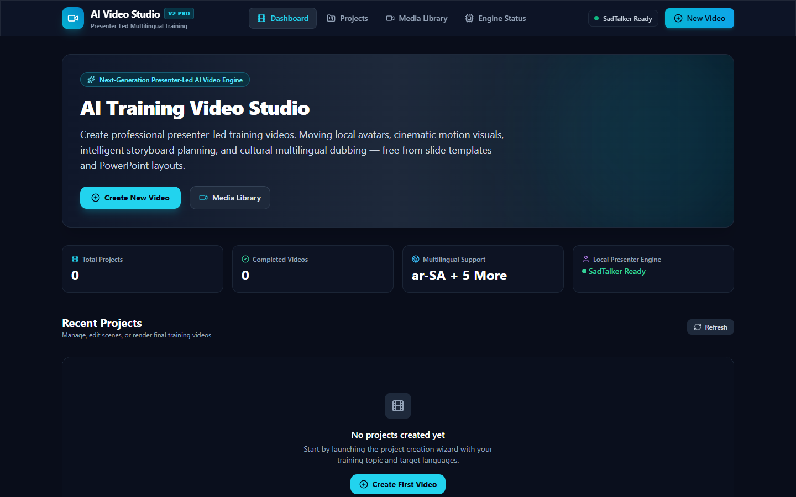
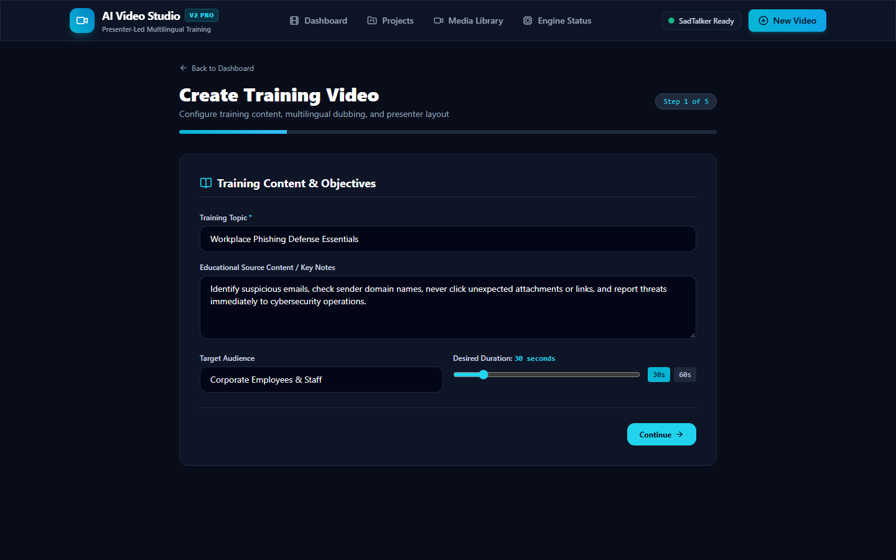
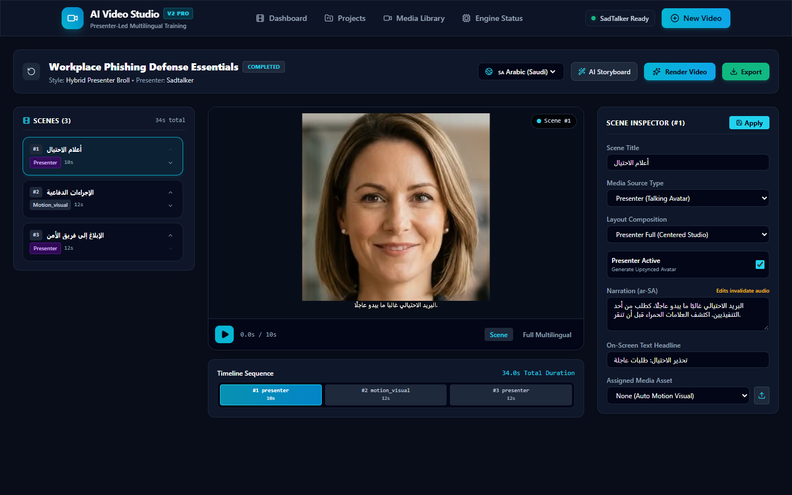
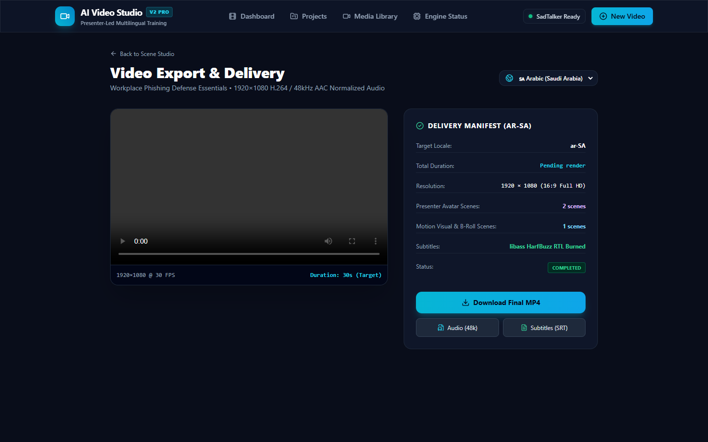
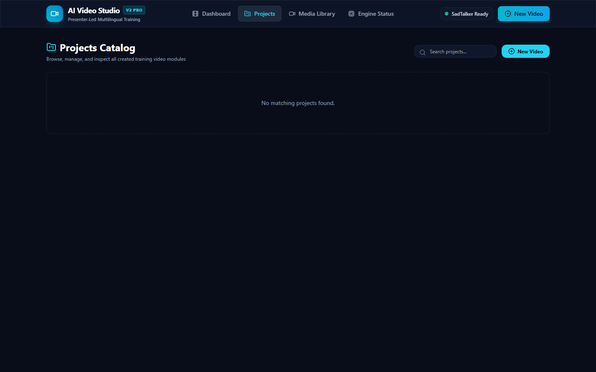
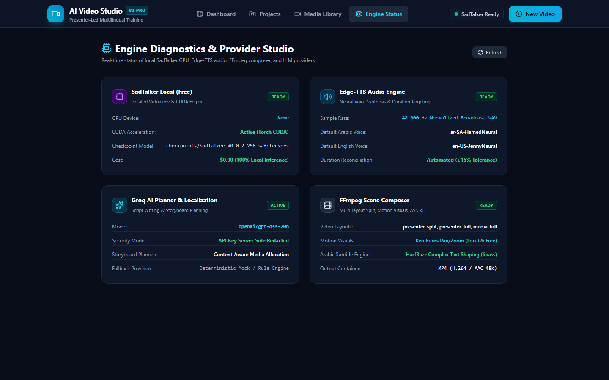
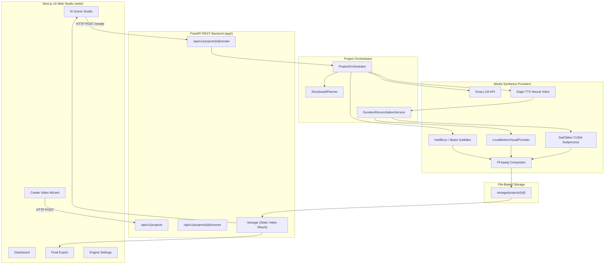

# AI Multilingual Training Video Studio

> An autonomous AI-powered platform for generating, localizing, editing, and rendering multilingual training videos using LLM-crafted scripts, neural voiceovers, local talking avatars, intelligent scene planning, RTL Arabic subtitles, and FFmpeg video composition.

[](https://www.python.org/)
[](https://fastapi.tiangolo.com/)
[](https://nextjs.org/)
[](https://www.typescriptlang.org/)
[](https://tailwindcss.com/)
[](https://groq.com/)
[](https://github.com/rany2/edge-tts)
[-7952B3)](https://github.com/OpenTalker/SadTalker)
[](https://ffmpeg.org/)
[](tests/)
[](web/tests/)
[](https://opensource.org/licenses/MIT)

---

## 📸 Hero Preview


*AI Multilingual Training Video Studio — Production Dashboard with live project catalog, system diagnostics, and quick creation workflows.*

---

## 💡 What This Project Does

Creating professional corporate training videos across multiple languages traditionally requires expensive camera crews, studio rentals, voice actors, translation agencies, and manual video editing timelines.

**AI Multilingual Training Video Studio** automates this entire lifecycle into a single unified platform:

```
[User Input: Topic / Curriculum / Duration]
                     │
                     ▼
        [1. AI Script Generation] ──► Structured educational scene breakdown (Groq LLM)
                     │
                     ▼
       [2. AI Storyboard Planning] ──► Scene classification: Presenter, B-Roll, Quiz, Outro
                     │
                     ▼
      [3. Multilingual Adaptation] ──► Localization into Arabic (ar-SA), Bengali (bn-BD), etc.
                     │
                     ▼
       [4. Neural Voice Synthesis] ──► Crystal-clear Edge-TTS speech per target locale
                     │
                     ▼
     [5. Duration Reconciliation] ──► Automatic speech pacing & script condensation to target duration
                     │
                     ▼
       [6. Scene Media Routing] ────► Local SadTalker (CUDA Avatar) OR Local Motion Visuals (B-Roll)
                     │
                     ▼
     [7. Arabic / RTL Subtitles] ──► Frame-accurate ASS / SRT with HarfBuzz complex text shaping
                     │
                     ▼
     [8. Native FFmpeg Assembly] ──► 1080p H.264/AAC multi-track video composition
                     │
                     ▼
          [Final 1080p MP4 Video] ──► Instant in-browser preview, scrubbing & download
```

The application provides two complementary operating workflows:
1. **Studio Mode (Recommended):** The AI generates the script, localizes it, and builds a visual storyboard. The user can then inspect, re-order, edit narration, toggle the avatar, upload custom media, and preview scenes before triggering the final render.
2. **Quick Generate & Render:** An automated zero-touch path that executes the complete pipeline end-to-end and renders the final video directly.

---

## ⚡ Core Features

| Feature Subsystem | Capability & Description | Status |
| :--- | :--- | :---: |
| **AI Script Generation** | Pedagogical scene structuring, duration budgets, and learning objective tracking using Groq (`openai/gpt-oss-120b`, `llama-3.3-70b-versatile`). | **Implemented** |
| **AI Storyboard Planner** | Automated assignment of media types (`presenter`, `broll`, `diagram`, `quiz`) and layout templates based on selected video style. | **Implemented** |
| **Multilingual Localization** | Cultural and linguistic script adaptation preserving technical terminology and educational objectives. | **Implemented** |
| **Neural Voice Synthesis** | High-fidelity multi-dialect speech synthesis via Edge-TTS (`ar-SA-HamedNeural`, `en-US-ChristopherNeural`, etc.) with word boundary metadata. | **Implemented** |
| **Duration Reconciliation** | Pre-render timing loop that measures synthesized speech and condenses text to match target project duration (e.g. strict 30s). | **Implemented** |
| **Local Talking Avatar** | Subprocess-isolated SadTalker engine running on local NVIDIA CUDA GPUs, generating 2D facial animation and lip-sync without paid API credits. | **Implemented** |
| **B-roll & Motion Visuals** | `LocalMotionVisualProvider` generating 1080p motion video clips from static assets using FFmpeg Ken Burns pan/zoom filters. | **Implemented** |
| **Next.js Video Studio v2** | Full-featured 3-column interactive workspace with live scene playback, script inspector, and draggable timeline. | **Implemented** |
| **Interactive Timeline** | Multi-scene timeline strip displaying scene sequence, individual scene lengths, active playhead, and total project duration. | **Implemented** |
| **Media Library** | Centralized project asset manager for uploading custom image/video clips and assigning them to specific scene layouts. | **Implemented** |
| **Arabic RTL Subtitles** | Advanced SubStation Alpha (`.ass`) subtitle engine utilizing HarfBuzz and libass for flawless Arabic right-to-left glyph shaping. | **Implemented** |
| **Native FFmpeg Compositor** | Automated complex filtergraphs assembling avatar PiP, motion backgrounds, audio normalization (48kHz stereo AAC), and burned-in subtitles. | **Implemented** |
| **Engine Status Diagnostics** | Live administrative dashboard checking GPU availability, VRAM, Groq connectivity, Edge-TTS status, and FFmpeg binaries. | **Implemented** |
| **Cloud Avatar Engine** | Optional external HeyGen API integration for high-tier cloud avatar synthesis. | **Optional** |
| **Photorealistic Generative B-Roll**| Text-to-Video models (Runway / Luma / Pexels API) for live culinary/physical demonstrations. | *Roadmap* |

---

## 🖥️ Dashboard

The primary landing page (`web/src/app/page.tsx`) provides high-level project visibility and rapid actions:


### Dashboard Capabilities
- **Project Quick Launch:** Single-click navigation to the 5-step **Create Video Wizard**.
- **Recent Projects Grid:** Live project cards showing thumbnail previews, topic title, target language flags (🇸🇦 Arabic, 🇺🇸 English, etc.), status badges (`Completed`, `Rendering`, `Pending`), and duration.
- **Project Actions:** Directly launch **Open Studio**, download final MP4, duplicate project manifests, or delete projects.
- **Provider Readiness Widget:** Quick visual status indicators for FastAPI Backend, Groq LLM, Edge-TTS, and SadTalker GPU.
- **Navigation Header:** Direct links to **Dashboard**, **Projects Catalog**, **Media Library**, and **Engine Settings**.

---

## 🪄 Create Training Video Wizard

The creation workflow (`web/src/app/create/page.tsx`) breaks video configuration into 5 intuitive, guided steps:

### Step 1 — Training Content
Define the core curriculum parameters:
- **Topic Title:** The primary educational subject (e.g., *"Saudi Kabsa Preparation Basics"*).
- **Source Material (Optional):** Raw documentation, recipe text, or curriculum notes for the LLM to synthesize.
- **Target Audience:** Select from *Beginners / General Public*, *Corporate Professionals*, *Technical Practitioners*, or *Academic Students*.
- **Target Duration:** Strict slider-based duration budget (15 to 300 seconds; defaults to 30s or 60s).


---

### Step 2 — Languages
Configure the canonical base language and target localized outputs:
- **Canonical Base Language:** The source language for initial script generation (e.g., `English (US)`).
- **Target Localized Languages:** Multi-select matrix supporting regional dialects (e.g., `Arabic (Saudi Arabia) - ar-SA`, `Bengali - bn-BD`).
- **RTL & Voice Information:** Automatically displays the assigned neural voice model (e.g., `ar-SA-HamedNeural`) and Right-to-Left formatting cues.


---

### Step 3 — Video Style
Select the instructional framing template to guide the AI Storyboard Planner:
- **Hybrid Presenter + B-Roll (Default):** Balanced composition alternating between talking-head presenter scenes and full-bleed visual demonstrations.
- **Presenter-Led:** Focuses on the instructor avatar with split-screen visual aids.
- **Visual Explainer:** Minimizes avatar presence in favor of continuous diagrammatic and B-roll visuals.
- **Demonstration / Tutorial:** Optimized for procedural tasks (e.g., cooking, hardware assembly, medical training).
- **Corporate Training:** Standard business format with structured title cards and key takeaway cards.


---

### Step 4 — Presenter Configuration
Choose the avatar synthesis engine:
- **SadTalker Local (Recommended):** Zero-cost neural avatar synthesis running on your local NVIDIA GPU.
- **Mock Engine:** Lightweight testing engine generating placeholder avatar visuals instantaneously for fast UI debugging.
- **HeyGen Cloud (Optional):** External commercial API integration for enterprise cloud avatars (requires user-provided API credentials).
- **Presenter Avatar Selector:** Choose from bundled high-resolution portrait characters.



---

### Step 5 — Generation Mode
Choose how to initiate the project:
- **Studio Mode (Recommended):** Generates canonical script and storyboard, then opens the Scene Studio for manual inspection, narration edits, and layout fine-tuning before video rendering.
- **Quick Generate & Render:** Immediately runs the entire pipeline end-to-end, rendering audio, avatars, motion visuals, and composing the final MP4 in one automated pass.

---

## 🎬 AI Scene Studio (Studio Mode)

The **AI Scene Studio** (`web/src/app/studio/[id]/page.tsx`) provides granular control over the planned video before triggering final rendering:



The Studio workspace is divided into three coordinated panels:

### 1. Scene List (Left Column)
- Displays all planned scenes in sequential order.
- Each scene card shows the scene number, title, assigned media type (`presenter`, `broll`, `diagram`, `outro`), and estimated duration in seconds.
- Clicking any scene loads its parameters into the Central Preview and Inspector.

### 2. Scene Preview & Playhead (Center Column)
- **16:9 Video Canvas:** Displays the rendered scene clip or pre-render placeholder.
- **Pre-Render Safety:** If the scene has not been rendered yet, the canvas displays an informative *"Scene not rendered yet"* placeholder with layout indicators, preventing 404 network errors.
- **Subtitle Safe Zone:** Visual overlay previewing lower-third subtitle placement and line length in both LTR and RTL scripts.
- **Mode Toggle:** Instant switching between individual **Scene Preview** and **Full Video Preview**.
- **Player Controls:** Play/pause toggle, timecode readout (`0.0s / 30.0s`), and volume controls.

### 3. Scene Inspector (Right Column)
- **Scene Title & Description:** Editable title for project organization.
- **Media Source Type:** Re-classify the scene as `presenter`, `broll`, `diagram`, `uploaded_media`, or `outro`.
- **Layout Composition:** Select the visual frame arrangement (e.g., `presenter_split`, `media_full`).
- **Presenter Toggle:** Enable or disable the talking avatar for this specific scene.
- **Narration Script Editor:** Edit the exact spoken voiceover for the selected locale.
- **On-Screen Text:** Define headline or takeaway overlays.
- **Assigned Media Asset:** Attach an uploaded image or video clip from the Media Library.
- **Save Changes:** Idempotently updates the project manifest and invalidates only affected downstream caches.

---

### Layout Modes

| Layout Mode | Description | Visual Structure | Typical Scene Role |
| :--- | :--- | :---: | :--- |
| `presenter_split` | 42% presenter video on left/right paired with 58% contextual media. | Split Screen | Core instructional delivery |
| `presenter_full` | Centered 960×960 framed avatar on dark studio slate with lower-third subtitles. | Full Focus Avatar | Introductions and conclusions |
| `media_full` | Full-bleed 1920×1080 cinematic visual or motion clip with subtitle overlay. | 100% Media Canvas | Demonstrations, B-roll footage |
| `media_with_overlay`| Full-bleed media background with semi-transparent keyphrase card. | Media + Overlay Card | Multi-step instructional points |
| `presenter_overlay` | Full-bleed media with presenter positioned in lower-right Picture-in-Picture. | PiP Layout | Software tutorials, walkthroughs |
| `title_card` | High-contrast title typography with subtle glowing ambient backdrop. | Clean Typography Card | Section transitions, title intro |
| `quiz_card` | Multiple-choice knowledge check layout with question and selectable choices. | Interactive Question | End-of-module assessment |

---

### Interactive Timeline

Located directly beneath the video canvas, the **Timeline Strip** (`docs/screenshots/v2/07_timeline.png`) visualizes the macro structure of the video:


- **Proportional Segment Blocks:** Each scene's width corresponds to its duration relative to the total project timeline.
- **Active Scene Highlighting:** The currently selected scene is highlighted with a cyan border and pulse marker.
- **Duration Readout:** Displays exact scene lengths and total aggregate video duration.
- **Direct Scrubbing:** Click any timeline segment to instantly switch the active scene editor.

---

## 🧠 Video Styles & Storyboard Intelligence

When generating a script, the LLM does not merely produce raw text—the **AI Storyboard Planner** (`app/workflows/storyboard_planner.py`) analyzes the narrative flow and automatically tags each scene with appropriate media types and layouts based on the chosen Video Style.

### Real Example: Saudi Kabsa Preparation Basics (`proj_b1c9c49c8259`)

| Scene # | Planned Scene Title | Video Style Allocation | Media Type | Layout Mode | Avatar Active? |
| :---: | :--- | :--- | :---: | :---: | :---: |
| **1** | Intro & Overview | Host introduction & recipe overview | `presenter` | `presenter_split` | **Yes** (SadTalker) |
| **2** | Rice Washing & Soaking | Physical preparation action | `broll` | `media_full` | **No** (Local Motion) |
| **3** | Chicken Browning & Onions | High-heat cooking technique | `broll` | `media_full` | **No** (Local Motion) |
| **4** | Spice Addition & Simmering | Whole spices & broth simmering | `broll` | `media_full` | **No** (Local Motion) |
| **5** | Plating & Garnish Outro | Final presentation & garnish wrap-up | `outro` | `presenter_split` | **Yes** (SadTalker) |

> ℹ️ **Transparency Note:** In the current implementation, B-roll scenes generated locally utilize `LocalMotionVisualProvider` (FFmpeg pan/zoom Ken Burns motion over procedural title cards or user-uploaded photos). They are not yet synthesized via photorealistic text-to-video generative AI models.

---

## 🌍 Multilingual Localization Pipeline

The platform is engineered from the ground up for high-fidelity localization rather than literal machine translation:

1. **Cultural Guidance Adaptation:** When localizing to `ar-SA` (Saudi Arabia), the localization prompt instructs the LLM to use natural Gulf terminology (e.g., using authentic culinary and cultural phrasing) while preserving core learning objectives.
2. **Right-to-Left (RTL) Layout Isolation:** Arabic scripts are tagged with `direction: "rtl"` metadata, prompting the UI and subtitle engines to switch alignment, padding, and text flow.
3. **Dedicated Locale Voice Mapping:** Each language maps to native neural voices:
   - `ar-SA` $\rightarrow$ `ar-SA-HamedNeural` (Male) / `ar-SA-ZariNeural` (Female)
   - `en-US` $\rightarrow$ `en-US-ChristopherNeural` / `en-US-JennyNeural`
   - `bn-BD` $\rightarrow$ `bn-BD-BashkarNeural`
4. **Independent Asset Bundling:** Every locale maintains its own localized scripts, audio waveforms, avatar lip-sync clips, subtitle tracks, and final MP4 deliverables in `storage/projects/{id}/final/training_{locale}.mp4`.

---

## 🎙️ Neural Voice Generation (Edge-TTS)

Speech synthesis is powered by the **Edge-TTS Neural Voice Engine** (`app/services/tts/edge_provider.py`):
- **Zero Cost & Unlimited Execution:** Uses high-fidelity neural WebSocket streams without per-character billing or API token caps.
- **Measured Duration as Ground Truth:** Once audio is synthesized to high-definition WAV, the backend probes the exact duration using `ffprobe`. This measured duration becomes the authoritative timing anchor for avatar generation, subtitle cues, and FFmpeg concatenation.

---

## ⏱️ Duration Reconciliation Engine

A common failure mode in generative video is **duration drift**: a user requests a 30-second video, but the generated voiceover takes 44 seconds to speak.

The platform includes a dedicated **Post-TTS Duration Reconciliation Engine** (`app/services/tts/reconciliation_service.py`):
1. **Measured Timing Comparison:** Probes synthesized audio waveforms against the user's target duration.
2. **Tolerance Checking:** If total speech duration exceeds the target by more than $\pm 10\%$, the reconciliation engine activates.
3. **Intelligent Text Condensation:** Prompts Groq with exact word-budget limits to trim filler phrases while preserving critical instructions.
4. **Re-Synthesis Loop:** Re-synthesizes audio with the condensed script and verifies duration compliance **before** triggering computationally heavy avatar rendering.

*Verified Result in Kabsa Test:* Initial speech was condensed and synthesized to **29.98 seconds** against a requested **30.0-second** target duration.

---

## 👤 Talking Avatar Generation (SadTalker)

The avatar subsystem (`app/services/avatar/sadtalker_provider.py`) generates talking-head video segments locally:

```
[Audio WAV Track] + [Presenter Portrait PNG]
                      │
                      ▼
        [Subprocess Isolation Barrier]
    (.sadtalker-venv / Python 3.10 / CUDA)
                      │
                      ▼
          [SadTalker Inference Loop]
   (3D Morphable Models + Facial Motion Warp)
                      │
                      ▼
        [1080p Video Clip with Lip-Sync]
```

### Architecture & Isolation
- **Subprocess Environment Isolation:** To prevent PyTorch and CUDA dependency conflicts with the main application runtime, SadTalker executes in a dedicated, isolated Python 3.10 virtual environment (`.sadtalker-venv`).
- **Hardware Acceleration:** Fully leverages NVIDIA CUDA acceleration (`torch.cuda.is_available()`). Tested and validated on an **NVIDIA GeForce RTX 4060 Laptop GPU**.
- **Idempotent Caching:** Avatar video files are hashed by portrait, audio waveform, and duration. Re-rendering unchanged scenes reuses cached video clips instantly.

### Current Avatar Limitations
SadTalker animates a 2D portrait headshot. It produces realistic facial expressions, eye blinks, and lip-sync, but **does not generate full-body movement, walking, culinary hand gestures, or environmental object manipulation**.

---

## 🖼️ B-Roll & Motion Visuals System

For non-presenter scenes, the **Scene Media Layer** (`app/services/media/`) handles visual rendering:
- **`UploadedMediaProvider`:** Allows users to upload their own photographs or video clips for specific scenes.
- **`LocalMotionVisualProvider`:** Takes static assets or modern dark-gradient canvases (`#090D1A`) and generates 1080p motion video clips using FFmpeg's `zoompan` filter:
  ```bash
  zoompan=z='min(zoom+0.0008,1.15)':d=150:x='iw/2-(iw/zoom/2)':y='ih/2-(ih/zoom/2)':s=1920x1080:fps=25
  ```
- **Ken Burns Dynamics:** Smooth 1.0x to 1.15x camera zooms prevent static presentation fatigue.

---

## 📁 Media Library

The **Media Library** (`web/src/app/media/page.tsx`) provides centralized media management:
- **Asset Uploads:** Upload JPEG, PNG, MP4, and WebM assets directly via drag-and-drop.
- **Project Association:** Uploads are stored in `storage/projects/{id}/media/` and indexed in the project manifest.
- **Scene Assignment:** In the Scene Studio, any scene can be switched to `uploaded_media` and assigned an asset from the library.

---

## 📝 Subtitle Engine & Complex RTL Arabic

Subtitle generation (`app/services/subtitles/`) supports multiple industry-standard formats:
- **Formats Generated:** SubStation Alpha (`.ass`), SubRip (`.srt`), and WebVTT (`.vtt`).
- **Complex Text Shaping (HarfBuzz & libass):** Arabic requires connected cursive glyphs and precise ligature shaping. The subtitle engine uses libass with HarfBuzz shaping to guarantee that Arabic characters never appear disconnected or left-to-right reversed.
- **Subtitle Safe Zones:** Subtitle positioning adheres to broadcast margins (bottom 10% safe zone) to prevent cropping on mobile screens.

---

## 🎬 FFmpeg Native Video Composition

Video assembly (`app/services/composition/service.py`) operates as a multi-stage FFmpeg pipeline:

```
[Presenter Clip] ─┐
[Motion B-Roll]  ─┼─► [Stage 1: Multi-Layer Scene Assembly] ──► [Scene MP4s (1..N)]
[Clean TTS Audio]─┤     (Overlay avatar, background, crop)               │
[ASS Subtitles]  ─┘                                                      │
                                                                         ▼
                                                     [Stage 2: Concatenation Demuxer]
                                                                         │
                                                                         ▼
                                                       [Final 1080p MP4 Video]
                                                    (Audio: 48kHz Stereo AAC)
```

1. **Per-Scene Assembly:** Composites the background motion visual, presenter avatar Picture-in-Picture, clean synthesized voiceover, and burned-in subtitles.
2. **Audio Normalization:** Enforces standard broadcast audio (48,000 Hz, stereo, 192 kbps AAC).
3. **Lossless Scene Concatenation:** Merges all rendered scene clips using the FFmpeg `concat` demuxer into the final deliverable: `storage/projects/{id}/final/training_{locale}.mp4`.

---

## 📦 Final Export

The **Final Export Page** (`web/src/app/studio/[id]/export/page.tsx`) provides post-render delivery:



- **Broadcast Video Player:** HTML5 player with full scrubbing and fullscreen controls.
- **Metadata Summary:** Total runtime (e.g. `29.98s`), resolution (`1920x1080 Full HD`), aspect ratio (`16:9`), and status badge (`Completed`).
- **Direct Deliverable Downloads:** One-click downloads for:
  - Final Composed Video (`.mp4`)
  - Full Subtitle Track (`.srt` / `.vtt`)
  - Full Localized Audio Track (`.wav`)
- **Scene Breakdown Table:** Itemized list of all rendered scene clips with individual duration readouts and download links.

---

## 📂 Projects Catalog

The **Projects Catalog** (`web/src/app/projects/page.tsx`) offers full lifecycle management:



- **Search & Filter:** Search projects by topic, title, or language code.
- **Status Filtering:** Filter by `Completed`, `Rendering`, `Pending`, or `Failed`.
- **Project Management:** Duplicate project configurations, open Studio mode, or delete project directories.

---

## ⚙️ Engine Status & Diagnostics

The **Settings & Diagnostics Page** (`web/src/app/settings/page.tsx`) inspects system readiness without exposing sensitive keys:



| Service Component | Inspected Metric | Typical Health Output |
| :--- | :--- | :--- |
| **FastAPI Backend** | Host, port, uptime, environment | `Operational (HTTP 200)` |
| **Groq LLM** | Active model, API readiness | `Ready (openai/gpt-oss-120b)` |
| **Edge-TTS** | WebSocket connectivity, voice library | `Ready (ar-SA-HamedNeural default)` |
| **SadTalker** | Isolated venv path, weights verification | `Ready (.sadtalker-venv / tools/sadtalker)` |
| **NVIDIA CUDA GPU** | GPU device name, VRAM, CUDA version | `NVIDIA GeForce RTX 4060 Laptop GPU` |
| **FFmpeg & ffprobe**| Executable binary path, version | `Installed (ffmpeg version 7.x)` |
| **HeyGen (Optional)**| Configuration status | `Disabled (Cost-Safe Mock Mode)` |

---

## 🏛️ System Architecture



---

## 🛠️ Technology Stack

| Architecture Layer | Technology / Package | Engineering Purpose |
| :--- | :--- | :--- |
| **Frontend Framework** | **Next.js 14.2 (App Router)** | High-performance React server and client components |
| **Language & Typing** | **TypeScript 5.0+** | Strict end-to-end interface and schema type safety |
| **Styling & Icons** | **Tailwind CSS + Lucide React** | Modern dark-mode interface and responsive controls |
| **Backend Core** | **FastAPI + Uvicorn** | Asynchronous RESTful API framework |
| **Data Validation** | **Pydantic v2** | Strict request/response modeling and serialization |
| **LLM Provider** | **Groq SDK** | Ultra-low latency script generation and planning |
| **Speech Synthesis** | **Edge-TTS** | Zero-cost neural text-to-speech across regional dialects |
| **Avatar Synthesis** | **SadTalker + PyTorch CUDA** | Audio-driven 2D facial animation on local GPU |
| **Audio Probing** | **mutagen + wave + ffprobe** | Waveform duration measurement as timing ground truth |
| **Image Processing** | **Pillow (PIL)** | Procedural visual generation and layout rendering |
| **Subtitles** | **libass + HarfBuzz** | High-precision RTL Arabic text shaping and burn-in |
| **Video Engine** | **FFmpeg 7.0+** | Complex filtergraph compositing, scaling, and concatenation |
| **Backend Testing** | **pytest (310 tests)** | Automated unit and integration testing suite |
| **Frontend Testing** | **Node Test Runner (27 tests)**| API contract validation and UI state verification |

---

## 📁 Repository Structure

```text
AI-Multilingual-Training-Video-Generator/
├── app/                              # FastAPI Backend Application
│   ├── api/v1/                       # REST Endpoints (/projects, /scenes, /health)
│   ├── core/                         # Configuration (Pydantic Settings), Logging, Caching
│   ├── models/                       # Domain Data Schemas (Pydantic v2)
│   ├── services/                     # Pluggable Service Implementations
│   │   ├── avatar/                   # SadTalker (CUDA), HeyGen (Cloud), Mock Providers
│   │   ├── composition/              # FFmpeg Scene and Concatenation Compositor
│   │   ├── llm/                      # Groq Provider and Prompt Templates
│   │   ├── localization/             # Script Localization and Cultural Guidance
│   │   ├── media/                    # LocalMotionVisualProvider, UploadedMediaProvider
│   │   ├── subtitles/                # HarfBuzz / libass ASS, SRT, VTT Generators
│   │   ├── tts/                      # Edge-TTS Provider & DurationReconciliationService
│   │   └── visuals/                  # Pillow 1080p Slide and Diagram Generators
│   ├── workflows/                    # Script Workflow & Storyboard Planner
│   └── main.py                       # FastAPI Application Entrypoint
├── web/                              # Next.js 14 Video Studio Frontend
│   ├── src/app/                      # App Router Pages (/create, /studio, /projects, /media, /settings)
│   ├── src/components/               # Reusable Studio UI Components
│   ├── src/lib/                      # API Client, Storage URL resolvers, Error formatters
│   ├── src/types/                    # TypeScript Data Interfaces
│   └── package.json                  # Next.js Dependencies
├── frontend/                         # Legacy Streamlit UI (Retained for debugging)
│   └── streamlit_app.py
├── scripts/                          # Automation & Setup Utility Scripts
│   ├── setup_sadtalker.ps1           # Automated SadTalker CUDA venv bootstrap script
│   └── run_kabsa_storyboard_demo.py  # End-to-end integration demo runner
├── docs/                             # Technical Documentation & Assets
│   ├── research/                     # Realism Gap Analysis & API Research Report (PDF/MD)
│   └── screenshots/v2/               # Production Studio Screenshots
├── storage/                          # Runtime File Storage (Ignored from git)
│   └── projects/                     # Persistent project manifests & generated media
├── tests/                            # 310 Automated Backend Pytest Suite
├── .env.example                      # Environment Configuration Template
├── requirements.txt                  # Python Backend Dependencies
└── README.md                         # Master Product Documentation
```

---

## 🚀 Local Installation Guide

### Prerequisites
- **Operating System:** Windows 10/11 (PowerShell instructions below), Linux, or macOS.
- **Python:** Python 3.10 to 3.13 installed (Tested on Python 3.13.5 for backend; Python 3.10 for SadTalker).
- **Node.js:** Node.js 18.x or 20.x+ with `npm`.
- **FFmpeg:** FFmpeg 6.0+ installed and accessible on system `PATH`.
- **NVIDIA GPU (Optional but Recommended):** NVIDIA GPU with CUDA drivers installed for local SadTalker avatar generation.

---

### 1. Clone & Python Environment Setup

```powershell
# Clone repository
git clone https://github.com/Ali-Developments/AI-Multilingual-Training-Video-Generator.git
cd AI-Multilingual-Training-Video-Generator

# Create Python virtual environment
python -m venv .venv
.\.venv\Scripts\Activate.ps1

# Install backend dependencies
python -m pip install --upgrade pip
pip install -r requirements.txt
```

---

### 2. Environment Variables Configuration

Copy `.env.example` to create your local `.env`:

```powershell
Copy-Item .env.example .env
```

Edit `.env` to configure your settings (all keys remain strictly backend-only):

```env
# Application Settings
ENVIRONMENT=development
DEBUG=True
APP_PORT=8000
APP_HOST=0.0.0.0

# LLM Configuration (Groq)
DEFAULT_LLM_PROVIDER=groq
GROQ_API_KEY=gsk_your_groq_api_key_here
GROQ_MODEL=openai/gpt-oss-120b

# Speech Synthesis (Edge-TTS Neural WebSocket - Free Tier)
DEFAULT_TTS_PROVIDER=edge_tts

# Avatar Provider (sadtalker = local GPU; mock = lightweight test)
DEFAULT_AVATAR_PROVIDER=sadtalker

# Cost-Safety Guard (Prevents accidental paid external calls)
ENABLE_LIVE_API_TESTS=False
ENABLE_LIVE_HEYGEN=False
```

---

### 3. SadTalker Local Avatar Setup (Optional for Local GPU)

If you have an NVIDIA GPU and want local talking avatar rendering:

```powershell
# Run the automated PowerShell setup script
.\scripts\setup_sadtalker.ps1
```

*What this script does:*
1. Clones the official OpenTalker/SadTalker repository into `tools/sadtalker`.
2. Creates an isolated virtual environment (`.sadtalker-venv`) using Python 3.10.
3. Installs PyTorch with CUDA acceleration (`cu118` / `cu121`).
4. Installs SadTalker dependencies and prepares checkpoint directories.
5. *Tested Hardware:* NVIDIA GeForce RTX 4060 Laptop GPU.

*(If you do not have an NVIDIA GPU, simply set `DEFAULT_AVATAR_PROVIDER=mock` in `.env` to run the complete studio with instant mock avatars).*

---

### 4. Running the Backend API

```powershell
# Ensure your virtual environment is active
.\.venv\Scripts\Activate.ps1

# Start FastAPI backend
python -m uvicorn app.main:app --host 0.0.0.0 --port 8000 --reload
```

- **Backend API:** `http://localhost:8000`
- **Swagger / OpenAPI Documentation:** `http://localhost:8000/docs`
- **Health Probe:** `http://localhost:8000/api/v1/health`

---

### 5. Running the Next.js Video Studio

In a separate terminal window:

```powershell
cd web
npm install
npm run dev
```

- **Next.js Studio Interface:** `http://localhost:3000`
- *(Next.js proxies backend API and `/storage` requests to `http://localhost:8000` automatically).*

---

### 6. Legacy Streamlit UI (Developer Debugging Only)

The legacy Streamlit dashboard is retained for backend diagnostic inspection:

```powershell
python -m streamlit run frontend/streamlit_app.py
```
*(Available at `http://localhost:8501`. Note: Next.js Studio is the primary V2 interface).*

---

## 🧪 Testing & Verification

The codebase maintains automated regression test suites across both backend and frontend layers:

### Running Backend Tests (pytest)
```powershell
python -m pytest -q
```
- **310 passing tests** covering API contracts, duration reconciliation, SadTalker subprocess isolation, Edge-TTS audio mapping, libass RTL Arabic subtitles, storyboard planning, and FFmpeg composition.

### Running Frontend Tests (Node test runner)
```powershell
cd web
npm test
npm run lint
npm run build
```
- **27 passing tests** covering create wizard serialization, locale parameters, avatar enum bindings, pre-render 404 elimination, and production compilation.

---

## 🔒 Security & Privacy Practices

- **Zero Secrets Tracked:** `.env`, API credentials, and runtime manifests are strictly ignored by `.git`.
- **Backend-Only Credentials:** API tokens (e.g. `GROQ_API_KEY`) are accessed strictly within backend server code and never exposed to client-side browser JavaScript.
- **Diagnostic Sanitization:** The Engine Status page (`/settings`) inspects service reachability without printing raw secret keys.
- **Cost-Safety Guards:** `ENABLE_LIVE_API_TESTS=False` prevents automated test suites from consuming external API quotas.

---

## ⚠️ Known Limitations

In the spirit of complete engineering transparency:

1. **Avatar Scope (SadTalker):** SadTalker animates 2D facial portraits. It does not synthesize full-body movement, walking, or physical hand gestures.
2. **Local B-Roll Motion:** The local B-roll engine (`LocalMotionVisualProvider`) generates cinematic pan/zoom motion over static graphic cards or user-uploaded photos. It is not equivalent to generative text-to-video foundation models.
3. **Complex Physical Actions:** Demonstrating physical actions (e.g. slicing onions, pouring boiling broth) requires user-uploaded media or future generative video APIs.
4. **Groq Free-Tier Rate Limits:** If using a free Groq account, requests may encounter rate-limit backoffs during rapid script replanning.
5. **Local Avatar Compute:** Local SadTalker avatar generation requires an NVIDIA GPU with CUDA. On CPU-only environments, use `DEFAULT_AVATAR_PROVIDER=mock`.

---

## 🗺️ Realism Roadmap

To close the visual realism gap identified during project audits, the recommended architectural path is documented in our comprehensive research report:
- **[VIDEO_REALISM_GAP_AND_API_RESEARCH_REPORT.md](docs/research/VIDEO_REALISM_GAP_AND_API_RESEARCH_REPORT.md)**
- **[VIDEO_REALISM_GAP_AND_API_RESEARCH_REPORT.pdf](docs/research/VIDEO_REALISM_GAP_AND_API_RESEARCH_REPORT.pdf)**

### Next Development Priorities:
- **Phase 1: Free Stock B-Roll API Integration:** Integrating the Pexels Video API to programmatically search and download real-world 1080p instructional footage (e.g., washing rice, sautéing onions) at zero cost.
- **Phase 2: Ambient Audio Production:** Adding royalty-free acoustic background music with automatic sidechain audio ducking under speech narration, plus culinary sound effects (sizzling, chopping).
- **Phase 3: Next-Gen Presenter APIs:** Integrating HeyGen Avatar V or Tavus Phoenix-4.5 for expressive torso and hand-gesture avatars.
- **Phase 4: Generative AI Video:** Routing culturally unique scenes to Runway Gen-3 or Luma Ray 3.2 APIs.

---

## 🌿 Git Branches & Repository Overview

| Branch Name | Purpose & Contents |
| :--- | :--- |
| **`main`** | Stable platform baseline. |
| **`local-video-generation`** | Verified local avatar generation and duration reconciliation pipeline. |
| **`video-studio-v2`** | Production Next.js 14 Video Studio, 3-column Scene Studio, and render actions. |
| **`video-realism-api-research`** | Comprehensive 19-page technical audit and video generation API research report. |
| **`readme-product-documentation`** | Active documentation branch with updated portfolio-grade product README. |

---

## 🖼️ Product Screenshot Gallery

| Dashboard Overview | Create Video Wizard |
| :---: | :---: |
|  |  |
| **Languages & Dialects** | **Video Style Selection** |
|  |  |
| **Presenter Setup** | **AI Scene Studio** |
|  |  |
| **Final Video Export** | **Engine Status Diagnostics** |
|  |  |

---

## 📊 Current Project Status

- **Core Multilingual Orchestrator:** ✅ Implemented & Verified
- **Edge-TTS Neural Voice Engine:** ✅ Implemented & Verified
- **Duration Reconciliation:** ✅ Implemented & Verified
- **Local SadTalker Avatar (CUDA):** ✅ Implemented & Verified
- **Arabic RTL Subtitle Engine:** ✅ Implemented & Verified
- **FFmpeg Video Compositor:** ✅ Implemented & Verified
- **Next.js Video Studio v2:** ✅ Implemented & Verified
- **Media Library Asset Manager:** ✅ Implemented & Verified
- **Photorealistic Generative B-Roll:** 🔬 Researched & Documented (Roadmap)

---

## 👤 Author & Engineering Attribution

**Ali Mostafa Ali**  
*AI Systems & Multi-Modal Automation Engineering*  
- **GitHub:** [@Ali-Developments](https://github.com/Ali-Developments)  
- **Repository:** [AI-Multilingual-Training-Video-Generator](https://github.com/Ali-Developments/AI-Multilingual-Training-Video-Generator)
