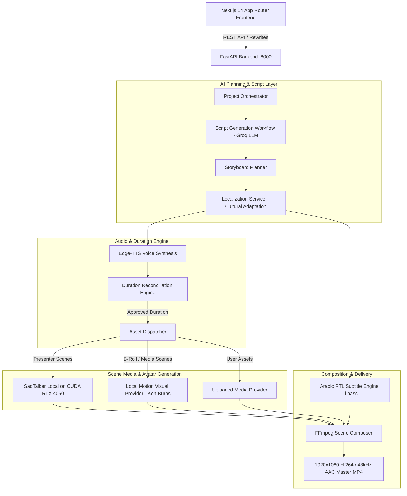

# System Architecture — AI Training Video Studio V2

## Overview

The AI Training Video Studio V2 transforms the platform from a slide-based prototype into an enterprise-grade, instructor-led video creation system. The architecture preserves the verified backend generation engine while upgrading the frontend, scene modeling, media orchestration, and visual composition.

---

## 1. System Topology

---

## 2. Core Architectural Pillars

### 2.1 Presenter-Led Visual Hierarchy
Unlike legacy slides with small corner avatars, V2 uses structured scene layouts:
1. **`presenter_split` (Primary Tutorial Layout):**
   - Presenter: 42% width (~806px) on studio slate backdrop.
   - Media: 58% width (~1114px) displaying motion visuals or B-roll.
   - Divider: Crisp 2px cyan line separating domains.
2. **`presenter_full` (Intro & Outro):**
   - Centered 960×960 framed avatar on dark studio canvas with dedicated lower-third subtitle area.
3. **`media_full` / `media_with_overlay`:**
   - Full-screen cinematic B-roll or motion visuals with lightweight contextual text.
4. **`quiz_card`:**
   - Formative evaluation layout displaying question prompt and option cards.

### 2.2 Storyboard Planner (`StoryboardPlanner`)
Positioned immediately following script generation, the Storyboard Planner analyzes the video style (`hybrid_presenter_broll`, `demonstration_tutorial`, etc.) and determines:
- Scene Media Type (`presenter`, `broll`, `motion_visual`, `quiz`, etc.)
- Layout Type (`presenter_split`, `presenter_full`, `media_full`, etc.)
- Media search terms and visual prompts.
- Explicit `avatar_enabled` boolean flags.

### 2.3 Post-TTS Duration Reconciliation Engine
SadTalker avatar synthesis is strictly deferred until audio duration is measured and reconciled:
1. Initial Edge-TTS synthesis produces exact measured audio duration.
2. If delta exceeds ±2.5s tolerance, Groq recalculates word count and generates reconciled narration.
3. Re-synthesized audio duration is approved.
4. Only approved audio is dispatched to SadTalker on CUDA, preventing wasted GPU cycles.

### 2.4 Dynamic Cache Invalidation
- **Narration changes:** Invalidate audio, avatar, subtitles, scene renders, and final video.
- **Layout or Media changes:** Invalidate scene render and final video without discarding existing audio/TTS.
- **Language changes:** Trigger targeted re-localization for the selected locale without invalidating unaffected language tracks.

### 2.5 Security & Secret Segregation
- `GROQ_API_KEY` and all external credentials reside solely on the FastAPI backend.
- Next.js client-side code never accesses private API keys.
- Hardware readiness endpoints expose only safe boolean flags and GPU device names (`NVIDIA GeForce RTX 4060`).
