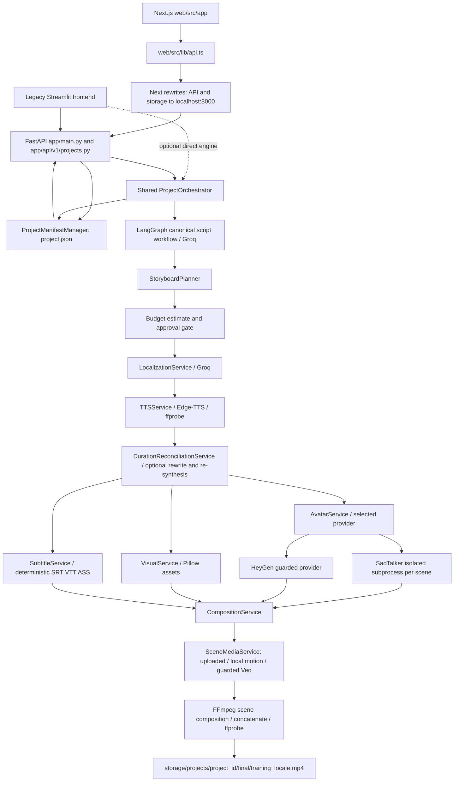

# Project technical audit

Audit date: 18 November 2026 (Africa/Cairo). Source baseline: `5b4a1513db1ea84e8e9e8dc79088fa8a397bd600` on `readme-product-documentation`.

## A. Executive summary

This is a substantial local development prototype with a FastAPI backend, Next.js Studio, an older Streamlit client, structured script/localization workflows, speech synthesis, isolated SadTalker inference, procedural motion graphics, ASS subtitles, and FFmpeg composition. Existing demonstration artifacts prove that the compositor has produced a four-layout Arabic video with a consistent presenter. They do not establish production reliability or natural, synchronized instructor performance.

The most urgent confirmed correctness defects are incomplete scene exports reported as completed, incomplete cache invalidation, and persistent presentation not being the default for the default hybrid workflow. The async render endpoints call synchronous orchestration directly, obstructing the event loop used by progress polling. Storage paths lack a central containment check, which is particularly consequential alongside deletion and arbitrary media path handling. Paid APIs have real configuration guards and are disabled in the inspected environment, but budget approval is not bound to the content and settings approved.

Do not replace SadTalker or the four layouts now. First repair the execution contract, completion criteria, cache dependencies, and renderer validation. Preserve the existing Python 3.10 SadTalker environment. Then evaluate presenter quality with audio-aware evidence and human review.

### Evidence standard and scope

- **VERIFIED_WORKING** means a narrowly described behavior was observed in this audit, a reproduction, a test, or an existing artifact. It does not mean the full feature passed live end-to-end acceptance.
- **IMPLEMENTED_NOT_VERIFIED** means source exists but its runtime behavior or quality was not independently established.
- **PARTIALLY_IMPLEMENTED**, **BROKEN**, **MISSING**, and **DEPRECATED** describe gaps against the product requirements, with evidence below.
- No production source, `.env`, billing setting, existing branch, existing artifact, or model environment was modified. No external inference request or paid API call was made. Test subprocesses performed local media work.
- Git remote refs were checked through `git ls-remote --heads origin`, without fetching or updating refs. Initial worktree was clean. No AGENTS.md was found in the repository file inventory.
- Existing Phase 9 and Phase 10 reports were read from `C:/Users/alimo/.gemini/antigravity/brain/1cef3562-e373-49d5-9114-c129543fdb2f/phase_9_local_validation_report.md` and `phase_10_persistent_presenter_report.md`. These reports are outside the repository and are historical claims, not new measurements.

## B. Actual architecture

### Repository and component map

| Area | Actual implementation and role |
|---|---|
| Entry point | `app/main.py`: FastAPI factory/lifespan, API routing, wildcard CORS, public static storage mount; host defaults to `0.0.0.0` when launched directly. |
| API | `app/api/v1/projects.py`: create/list/get/update/delete/duplicate, scenes/edit/reorder, media upload/list, script/bootstrap/storyboard, render/run/resume/retry, outputs, budget/approval/status/providers. `health.py` checks storage. |
| Data contracts | `app/models/schemas.py`: request, script/scene, localized bundle, per-scene assets, tracks, final video, project manifest, budget and error models. Python and TypeScript contracts are maintained separately. |
| Script engine | `app/workflows/script_generation/{graph,nodes,state,prompts,validators}.py`: normalize, analyze, generate, validate, revise, finalize/review using LangGraph. `llm/factory.py` currently supports Groq. |
| Studio planning | `app/workflows/storyboard_planner.py`: rule/keyword-based media/layout planning; its presence and AI terminology do not establish LLM-designed visual pedagogy. |
| Pipeline | `app/workflows/orchestrator.py`: synchronous sequential stages, manifest checkpoints, stage-level reuse, per-locale containment, duration gate and completion assessment. |
| Providers | Separate `base.py`, `factory.py`, concrete providers and service wrappers in `tts`, `avatar`, `visuals`, `subtitles`, `composition`; scene media routing is in `media/service.py`. |
| Persistence | `app/workflows/manifest.py`: per-project in-process read/write locks and atomic temporary-file replacement. No transactional read-modify-write job reservation or cross-process coordination. |
| Assets | `storage/projects/<id>/{scripts,audio,avatars,visuals,subtitles,media,rendered,final}`; content sidecars in `app/core/caching.py`. Demo outputs are separately under `storage/demonstrations`. SadTalker temporary results under configured `SADTALKER_RESULT_DIR`. |
| Frontend | Next App Router create/projects/studio/export/media/settings pages; Studio calls REST, polls stage status and plays static MP4 URLs. `frontend/streamlit_app.py` and `helpers.py` remain an older second client. |
| Jobs | Provider job IDs/polling and manifest stage statuses exist. A durable background job queue, GPU semaphore, cancellation, heartbeat and crash recovery worker are missing. `/render`, `/run`, `/resume` execute synchronously inside async route functions. |
| Configuration | Pydantic Settings from `.env`; `.env.example`; runtime Python requirements and `web/package.json`/lockfile. Main environment and isolated SadTalker environment are separate. |
| Tests/scripts | `tests/test_*.py`, `web/tests/*.test.mjs`, various manual/live acceptance scripts. Ordinary discovery excludes `run_*.py` and `check_heygen_avatars.py`; those manual scripts must not be mistaken for safe ordinary tests. |

### End-to-end details and divergences

Studio preparation generates the canonical script and plans scenes without rendering. Full execution loads the manifest, resolves the project avatar provider, reuses or generates the script/storyboard, estimates budget, localizes, synthesizes speech, reconciles real audio durations, generates avatars and visuals, writes subtitles, generates supporting motion during composition, composes scenes and concatenates successful scene files.

The four Phase 10 layouts are implemented in the real compositor, not only in TypeScript. However, `run_phase10_persistent_presenter.py` constructs fixed demonstration scenes and directly invokes providers/composition. Its success does not exercise normal project creation, saved edits, shared provider state, cache invalidation, or API progress.

Paid provider factories and providers both check live gates. Veo failures at `SceneMediaService` are caught and replaced by local motion, with a log warning; the provider itself does not perform that fallback. The resulting substitution is not a structured scene result exposed to the Studio.

## C. Feature inventory

| Feature | Status | Evidence and limitation |
|---|---|---|
| Topic/raw training text request | IMPLEMENTED_NOT_VERIFIED | `TrainingVideoRequest`, create API and create page. API tests are part of the recorded offline run; no fresh user-driven browser acceptance was performed. |
| PDF/DOCX content ingestion | MISSING | Request accepts `source_content`; media upload is an image/video asset route, not document extraction. No dedicated extraction pipeline was found. |
| Structured scripts and learning objectives | IMPLEMENTED_NOT_VERIFIED | LangGraph workflow and validators present; Groq was not called. Orchestrator has a draft-adoption path that merits explicit review policy. |
| Localization | IMPLEMENTED_NOT_VERIFIED | Locale utilities, protected-field validators, bounded revisions and partial locale handling exist. No fresh language-quality assessment. |
| Voice synthesis | PARTIALLY_IMPLEMENTED | Edge-TTS implementation and existing Arabic audio available; defaults/overrides exist at provider level, but a saved per-project voice contract is absent. Unknown locale falls back to English. No fresh external TTS request. |
| Duration reconciliation | PARTIALLY_IMPLEMENTED | Measured audio, bounded revisions and needs-review gate exist. Cached approval is not fingerprinted against target/current narration; an older localization reconciliation hook is also called and its result discarded. |
| Local SadTalker runtime | VERIFIED_WORKING | Readiness and actual isolated interpreter CUDA checks passed. This verifies environment availability, not fresh inference or output quality. |
| All four persistent layouts | VERIFIED_WORKING | Source branches, existing final MP4 and newly extracted boundary samples demonstrate the four layouts. |
| Presenter persistence in default workflow | BROKEN | Default hybrid request has `persistent_presenter=None`; planner falls back to undeclared `PERSISTENT_PRESENTER_ENABLED=False`. Reproduction yields middle `avatar_enabled=False`, `layout_type=media_full`. Frontend serializer sends no persistent flag. |
| Presenter identity selection | BROKEN | Serializer emits `avatar_id`; Python request model ignores it. Orchestrator does not pass a selected portrait to `generate_bundle_avatars`. Reproduction confirms field loss. |
| Natural lip sync, blinking, gestures | IMPLEMENTED_NOT_VERIFIED | Avatar clips and facial differences exist; pixel movement is not phoneme alignment. No full-body gesture generation found. SadTalker still mode defaults true. No validated AV-sync metric or listening review in this audit. |
| Educational visual generation | PARTIALLY_IMPLEMENTED | Pillow motion archetypes cover email/security/incident workflows and a general fallback. English keyword classification and canned English interfaces limit arbitrary subjects and localized storytelling. |
| Arabic ASS rendering | PARTIALLY_IMPLEMENTED | Existing burned Arabic captions look joined in sampled frames; native libass shaping is used without manual reversal. Timings are proportional text chunks, not forced alignment. Mixed script, long lines and pronunciation remain unverified. |
| Studio scene editing/preview | PARTIALLY_IMPLEMENTED | Inspector, scene REST routes, preview URL gating, timeline and final playback exist. Saved edits are not consistently propagated into all cache dependencies. No browser interaction was performed. |
| Project metadata PATCH | BROKEN | Route reads `payload.base_language`, absent from `UpdateProjectRequest`; topic-only direct route reproduction raises AttributeError with a mocked manager before saving. |
| Progress and active-provider truth | PARTIALLY_IMPLEMENTED | `/status` counts seven completed stages; it has no active scene, actual device, inference telemetry, or durable job identity. Provider availability can be reported independently of safety permission. |
| FFmpeg final export | PARTIALLY_IMPLEMENTED | Existing final file decodes, but service drops failed scenes before concatenation and may report completed. Required avatar/subtitle constraints are not strict export gates. |
| Paid API safety | PARTIALLY_IMPLEMENTED | Closed configuration gates independently observed; HeyGen acknowledgment and orchestrator budget gate implemented. Approval does not bind to a plan fingerprint and update contracts are weaker. |
| Retry/resume | PARTIALLY_IMPLEMENTED | APIs and manifest reuse exist; no durable worker recovery; stale stage flags can skip content checks. |
| Streamlit | IMPLEMENTED_NOT_VERIFIED | Legacy second workflow still exists; no explicit deprecation/removal decision is warranted by this audit. |
| Automated validation | PARTIALLY_IMPLEMENTED | Backend suite, 33 passing frontend logic tests and passing TypeScript check; many frontend tests assert simulated state rather than execute components. Phase 10 compositor test mocks FFmpeg and probe results. |

## D. Technical debt and confirmed failure mechanisms

1. **Incomplete output can be called complete.** `CompositionService.compose_locale_final_video` filters to successful scene files, invokes the concatenator and retains its completed status without requiring all expected IDs. Isolated mock reproduction with one completed and one failed input returns `completed`, `scene_count=1`. The same method's final-cache path also returns completed for the subset. Orchestrator assesses final video statuses rather than complete scene coverage. This is a P0 integrity defect.
2. **Storage containment is absent.** `ProjectManifestManager.get_project_dir` joins a caller-controlled ID to the root and creates it; absolute paths or `..` can escape. Create accepts a custom project ID. APIs include recursive project deletion, media paths accept existing absolute files, and uploads concatenate the original filename into a disk path. No destructive exploit was attempted. Treat as P0 before exposing the API beyond a trusted machine. Validate IDs and resolve/check containment centrally; do not rely on URL routing alone.
3. **Render blocks progress.** `/render`, `/run`, `/resume` call the synchronous orchestrator directly in `async def`. Some script/bootstrap routes already use `run_in_threadpool`, showing inconsistent treatment. Five-minute Next proxy timeout is not a durable job mechanism. A minimal threadpool fix needs per-project exclusion and a single GPU execution guard; otherwise shared services can race.
4. **Shared provider state.** API module creates one orchestrator. `run_project` mutates `self.avatar_service.provider` for selection and deliberately leaves a mock provider unchanged. This means injected mock state can execute despite another selection; future concurrent threadpool execution makes cross-project provider mutation hazardous. Build provider context per job and record actual selection/execution.
5. **Caches do not reflect all inputs.** Orchestrator reuses completed whole tracks before per-scene checks. Composition writes `audio_hash` but its reuse condition only reads duration, avatar presence and layout. Presenter position, subtitle content, source portrait, media content and encoding settings are omitted. VisualService trusts an existing readable image. Motion cache excludes narration/title/content. Avatar cache caller omits portrait path, and metadata does not save `portrait_hash`. Project update does not systematically invalidate downstream stages; scene edits reset selected flags but not every dependency.
6. **Phase 10 persistence activation is incomplete.** See inventory/reproduction. Changing scene defaults and adding dropdown entries did not make the normal hybrid planner persistent. Preserve explicit opt-out where required; use one documented default and propagate it through request, UI, planning and validation.
7. **Subtitle fallback masks unmet requirements.** FFmpeg retries unburned and returns a completed scene with `has_subtitles=False`. Orchestrator marks subtitle generation completed without checking track results. Caching may later label an unburned render as subtitled simply because a subtitle asset exists.
8. **Avatar validation can misattribute output.** SadTalker falls back from job-local candidates to any MP4 under a shared root temp tree. That can select an unrelated previous result after a nominally successful process. Readiness infers device from `CUDA_VISIBLE_DEVICES`, not the isolated interpreter; API GPU status imports main-environment torch. Actual inference output has no strong per-job portrait/audio provenance check.
9. **Approval is not immutable.** Budget calculation preserves previous approved/rejected status after plan changes. Project PATCH can set `avatar_provider` without the acknowledgment validation used by `TrainingVideoRequest`; the orchestrator/config gates still apply, so this is not a claim that disabled gates can be bypassed. Fingerprint provider, scenes, locales, durations, rates and maximum spend; invalidate approval on changes. Veo estimated usage also lacks explicit locale multiplication and should match actual execution/reuse policy.
10. **Dependencies are not reproducible.** `requirements.txt` omits directly used packages including `edge-tts`, Pillow, requests and `python-multipart`, and uses broad minimum bounds. Installed environment working does not prove clean install success. Main Python is 3.13.5; isolated SadTalker is 3.10.18. Frontend has a lockfile; no backend lock was found.
11. **Error and resource handling remain uneven.** Broad exceptions include swallowed optional reconciliation-hook errors and logged media substitutions. Manifest error sanitization exists, but root logger has no universal secret-redaction filter, and provider/subprocess error text reaches logs. Atomic writes protect file integrity, not whole job transactions. Temporary results and provider `_jobs` maps have no bounded retention policy; each SadTalker scene starts a new subprocess/model load.
12. **Visual contracts are resolution-specific.** Layout filtergraphs hardcode 1920/1080/806/1114/480 while settings advertise configurable dimensions/FPS. Split visuals use center crop, removing content from full-width graphics. Presenter video is not explicitly duration-validated against the entire narration before composition; FFmpeg overlay EOF behavior can hold the last frame.
13. **Project PATCH is broken by schema drift.** `update_project` unconditionally reads `payload.base_language`, but `UpdateProjectRequest` has no such field. A direct async route reproduction with a mocked manifest manager raises `AttributeError` even for a simple topic-only update, before saving. Fix the model/route contract alongside roadmap #6; add an actual TestClient PATCH test. This is a confirmed P1 API defect, separate from cache invalidation.
14. **Audio standardization is not loudness mastering.** FFmpeg sets codec, sample rate, channels and bitrate; no `loudnorm`/loudness target is present in this compositor. `TTS_TIMEOUT_SECONDS` is declared but the Edge-TTS save operation shown has no explicit timeout wrapper. Measure loudness/clipping/gaps and bound network speech operations before describing professional audio mastering or robust external-service recovery.
15. **Storyboard approval is inferred from metadata completeness.** `has_existing_storyboard` requires every scene to have `preferred_provider`; a manually approved scene missing this optional field is replanned. The failing reuse test demonstrates this behavior. Use an explicit plan revision/approval state and fill missing dispatch metadata without replacing user choices. Tutorial planning also checks keywords without honoring `scene_type=demonstration` in that branch, unlike hybrid planning; the Kabsa test exposes this mismatch. Fix these alongside roadmap #3/#4, keeping any intentional presenter visibility changes explicit.

## E. Video quality audit

### Newly measured artifact

File: `storage/demonstrations/phase10_persistent/final/training_ar-SA.mp4`.

| Property | Independent result |
|---|---|
| File size | 2,340,661 bytes |
| Container duration | 36.101016 seconds |
| Video | H.264, 1920×1080, nominal 25/1 FPS, 902 frames reported and decoded with passthrough frame timing |
| Audio | AAC, 48,000 Hz, stereo; historical Phase 10 report says 44.1 kHz, which does not match this artifact |
| Rendered scene container durations | 10.64, 8.08, 9.84, 7.52 seconds; sum 36.08 seconds |
| Sampled times | 0, 4, 8; five points around each 10.64/18.72/28.56 boundary (±0.08/0.04/0); 31.5 and 35.96 seconds: 20 samples total |
| Full decode check | All 902 frames decoded at 320×180 grayscale; zero frames with mean intensity under 2/255; zero exactly identical adjacent downscaled frames |
| Mean adjacent full-frame difference | 0.29909 on a 0–255 grayscale scale |

Saved evidence: [boundary contact sheet](../storage/audit_20261118/phase10_boundary_contact_sheet.png), [probe/decode JSON](../storage/audit_20261118/video_evidence.json), [reproduction results](../storage/audit_20261118/reproduced_findings.json). Evidence generation script: `storage/audit_20261118/inspect_video.py`. Passthrough timing is important: default FFmpeg rawvideo output added a duplicate frame; the final measurements above use `-fps_mode passthrough`.

### What the images establish

- Same recognizable presenter identity in all inspected samples, including cuts. Presenter is large in split layouts, smaller but visible in PiP, and centered at the end. No sampled missing presenter or black cut was observed.
- Composition balance needs work: side-by-side layouts crop the full-width motion graphic. In scene 3 the left-side label/content is cut at the canvas edge. In scene 1 the supporting panel has a large empty area and small text. The centered scene reduces teaching content to a small preview; labels are too small at this displayed scale. PiP is more compatible with full-width email content, but bottom-right occupancy and subtitles need safe-zone checks.
- Arabic captions are visibly present and appear joined in these samples. Technical visual labels remain substantially English. This is not a complete Arabic reading, punctuation, mixed-script, or overflow audit at all subtitle times.
- Cuts show abrupt reframing of the same portrait; no continuous full-body performance or meaningful hand gestures is established. Existing Phase 9 presenter contact sheet shows subtle face/mouth changes, not proof of natural instructor delivery.

### What remains unverified

**Do not report 100% presenter visibility as a measurement.** The demonstration script literally assigns `presenter_visibility_percent: 100.0` and `all_scenes_have_talking_avatar: True` after taking 12 screenshots. It runs no detector over every frame. The new full-frame scan checks black/duplicate frames, but background motion can conceal a frozen face. Its thresholds are heuristic, not perceptual quality metrics.

Actual audio-to-mouth alignment, drift, phoneme correctness, blinking/gaze naturalness, face landmarks, local face freezes, voice pronunciation, perceived audio quality and gesture quality require targeted measurements and listening/watch review. No audio listening review was performed. Do not infer them from pixel differences. No fresh GPU generation was run. Historical inference times below are labeled accordingly.

The existing Phase 9 final MP4 and its presenter/B-roll evidence are available. Phase 9's selected presenter scenes are historical design, not a newly discovered Phase 10 defect. The production-default persistence defect was separately reproduced against the current planner.

### Report discrepancies

Phase 10 report describes 960/960 split and rounded/shadow PiP; actual code uses 806/1114 and rectangular border. It says 903 frames and 44.1 kHz; the inspected stream has 902 frames and 48 kHz. Its absolute evidence links are machine-specific. The script reuses Phase 9 avatars for scenes 1/4 if present, so the existence of four avatar files does not independently prove four fresh CUDA jobs in that run.

## F. Performance and environment audit

| Check | Result / interpretation |
|---|---|
| Main interpreter | `.venv` Python 3.13.5; pytest 9.1.1. |
| Isolated SadTalker | `../.sadtalker-venv/Scripts/python.exe`: Python 3.10.18, PyTorch 2.7.1+cu118, CUDA build 11.8, `torch.cuda.is_available() == True`, RTX 4060 Laptop GPU. No environment replacement needed. |
| Runtime assets | Actual resolution finds `../tools/sadtalker`, mapping checkpoints and 256 safetensors, project portrait. Readiness true outside sandbox. Sandbox initially hid these paths; that was not a broken user installation. |
| GPU inventory | NVIDIA RTX 4060 Laptop GPU, 8188 MiB total; 1952 MiB used at one idle inspection. This is not inference peak VRAM. |
| New evidence scan | Approximately 3.39 seconds for 20 frame extractions plus downscaled full decode on this machine. Not a generation benchmark. |
| Historical Phase 9 inference | Report: 117.4 s for 10.61 s scene 1; 65.4 s for 7.51 s scene 4. Not remeasured. |
| Historical Phase 10 inference | Handover reports 49.4 s/8.06 s and 57.1 s/9.82 s for scenes 2/3. Not remeasured. |
| Main current output settings | `VIDEO_FPS=30`; existing demonstration is 25 FPS. Do not treat demo settings as application defaults. |
| Bottlenecks supported by source | Per-scene model subprocess initialization; sequential scenes/locales; CPU Pillow frame generation and x264 encoding; whole-track caching can skip correctness checks. |

Peak inference VRAM/RAM, temperature/power, model load time, composition time, disk peak and end-to-end p50/p95 remain unmeasured. First establish a fixed local benchmark with cold/warm states and a single GPU worker. Do not add parallel GPU inference. A persistent worker/model-reuse proposal should follow measurements and timeout/recovery design.

## G. Cost and safety audit

Independent safe-settings inspection showed `DEFAULT_AVATAR_PROVIDER=sadtalker`, `DEFAULT_MEDIA_PROVIDER=motion_visual`, `ENABLE_LIVE_HEYGEN=False`, `ENABLE_LIVE_VEO=False`, `ENABLE_LIVE_API_TESTS=False`. No key values were printed. Defaults in source differ: avatar defaults to HeyGen, while `.env.example` selects mock. Align documentation and explicit startup behavior before clean installation acceptance.

Factories guard provider creation; HeyGen and Veo also guard actual live operations, including extra pytest protection. No local-provider failure path was found that silently selects a paid provider. Veo-to-local substitution is the reverse and remains insufficiently visible to users. Configuration locking is effective defense in depth; it does not replace per-job authorization.

The orchestrator estimates cost and pauses before media work when approval is required. Budget APIs exist. However, approval must be bound to a frozen plan/revision and authenticated approver before paid use. Direct provider calls check configuration, not the project approval object. Groq has no corresponding application approval flag and Edge-TTS sends text externally; describe these as external services, even when they incur no charge. This audit did not call either.

No authentication/ownership layer was found on project mutations, budget approval, or static assets. Wildcard CORS, network binding, arbitrary path handling and unrestricted uploads are unsuitable for hosted/multi-user deployment. File type/content/size checks, safe filenames, scoped paths and access control are required. Avoid logging raw provider error payloads or secrets; redact at the logging boundary and test with sentinel keys.

## H. Git and release status

| Ref | Verified SHA / status |
|---|---|
| Current branch / HEAD | `readme-product-documentation`, `5b4a1513db1ea84e8e9e8dc79088fa8a397bd600` |
| Local main / tracking origin/main | `db7f0d04208b7e332c8b9d297be2927966e1b3b5` |
| Actual remote main | `db7f0d04208b7e332c8b9d297be2927966e1b3b5` via ls-remote |
| Actual remote development | `5b4a1513db1ea84e8e9e8dc79088fa8a397bd600` via ls-remote |
| Remote backup | `backup/main-before-phase9-sync-2026-11-09`, `3bdf56a5f6e5e431d83f36df065008a5a9150c6a` |
| Initial worktree | Clean; git emitted sandbox user-global-ignore permission warnings. |
| Main-to-development delta | One Phase 10 commit; 8 files, 842 insertions, 108 deletions. Schemas, avatar eligibility, FFmpeg layout code, storyboard planner, demo script, Phase 10 tests, Studio page and TS types. |

No merge, push, reset, checkout, branch deletion or history rewrite was performed. Other historical local branches exist; only main/development/backup were independently observed on remote. Audit deliverables remain uncommitted for review. Create a `codex/` working branch before substantial fixes; preserve the backup. Do not merge into main without explicit approval.

## I. Prioritized improvement roadmap: first ten changes

Order is intentional. Each item is a focused change, not permission for a major replacement.

| # / priority | Problem, evidence and impact | Recommended change / exact first files | Dependencies and risk | Acceptance tests / criteria |
|---|---|---|---|---|
| 1 / P0 | Uncontained IDs/paths can reach outside project storage; public API lacks ownership. Potential read/write/delete exposure. | Central safe ID and resolved containment helper in `app/workflows/manifest.py`; constrained request IDs in `app/models/schemas.py`; safe upload/media paths and size/type checks in `app/api/v1/projects.py`, `app/services/media/service.py`; access/bind policy in `app/main.py`. | First, before deployment. Medium compatibility risk for legacy IDs/absolute assets; inventory valid existing paths and preserve them. | Temporary-root tests for absolute, drive/UNC, encoded/backslash traversal and symlinks; safe deletion target checks; upload size/type tests; no write/delete outside fixture root; unauthorized mutations denied in hosted mode. |
| 2 / P0 | Failed scenes are dropped and final status remains completed. Proven service reproduction. | Require exact ordered expected scene/locale coverage in `app/services/composition/service.py` and `app/workflows/orchestrator.py`; validate export in `ffmpeg_utils.py`. | Independent of visual redesign. Low-medium risk: degraded exports that previously looked successful now fail/review. | One failed/missing/duplicate scene, absent audio or locale must prevent completed export; all expected IDs once in order; duration/streams match. Include cached-final path. |
| 3 / P1 | Default hybrid removes presenter; UI cannot convey persistence. | Declare consistent persistence default in `app/core/config.py`, `app/models/schemas.py`; pass through `web/src/types/index.ts`, `web/src/app/create/page.tsx`; honor in `storyboard_planner.py`, eligibility and composition gates. | After completion policy. Medium risk: longer GPU/cost duration and intentional presenter-free styles; make opt-out explicit and estimate full usage. | Real default create payload produces avatar-required scenes throughout; opt-out respected; absent/short avatar fails strict mode; sample rendered boundaries. |
| 4 / P1 | Reuse ignores changed audio/content/portrait/position/subtitles/settings and whole-stage flags bypass checks. | Dependency fingerprints in `app/core/caching.py`, `app/workflows/orchestrator.py`, `app/api/v1/projects.py`, `app/services/composition/service.py`, `avatar/service.py`, `visuals/service.py`, `media/motion_visual_provider.py`. | Needs canonical request/scene revision. Medium-high invalidation risk and initial rerender expense; never delete original assets to test. | Same-duration narration replacement, portrait/voice/position/title/media/subtitle/branding/target edits each invalidate exactly dependent outputs; unchanged inputs reuse; reordered final hash changes. |
| 5 / P1 | Async render blocks polling; shared provider mutation and no job exclusion threaten isolation. | Immediate threadpool boundary plus per-job provider/service context in `app/api/v1/projects.py`, `app/workflows/orchestrator.py`; project execution lock and single GPU guard. Durable jobs only after design review. | After path and integrity guards. Medium-high concurrency risk; moving to threads without isolation is insufficient. | Concurrent status stays responsive during fake slow render; duplicate same-project submissions deduplicated; two different provider projects cannot exchange provider state; one GPU job at a time; interrupted job recoverable. |
| 6 / P1 | Avatar/voice selections lost; provider readiness can misstate actual execution. | Add validated presenter/voice fields to `app/models/schemas.py`, TS contracts, orchestrator and avatar/TTS services. Query actual isolated-device readiness in `avatar/sadtalker_provider.py` and provider API; record actual provider/device/source hashes. | Coordinate #3/#4/#5. Medium migration risk; default existing manifests explicitly. | UI-to-backend-to-provider payload tests; chosen portrait and voice preserved; unknown locale does not silently speak English without surfaced policy; isolated CUDA CPU/OOM status correct. |
| 7 / P1 | Subtitle failure silently produces completed unburned output; timings approximate and layouts crop diagrams. | Required subtitle policy in `app/services/composition/ffmpeg_provider.py`, service/export checks; layout-aware visual canvas and safe zones in `media/motion_animator.py`, `visuals/local_provider.py`; improve `subtitles/formatter.py` and timing metadata when available. | #2/#3/#4 first. Medium visual regression risk; retain four layouts. | Real local FFmpeg tests for each layout, malformed ASS, missing fonts, Arabic/English/numbers/braces/long lines; no unexpected unburned success; face/text/visual safe zones at 1080p and configured sizes. |
| 8 / P1 | Stale approval survives provider/scope changes; estimates differ from execution. | Immutable plan/cost fingerprint in `app/services/budget/service.py`, schemas, approval/update APIs and orchestrator; enforce at provider dispatch boundary. | Requires revisions from #4/#6. Medium compatibility risk: old approvals should require renewal. | Disabled gates prohibit any HTTP request; changed locale/duration/provider/scene invalidates approval; direct dispatch lacks authorization fails; costs reflect all locales and persistent presenter; mocks only. |
| 9 / P2 | Fragile SadTalker output discovery, per-scene reloads, retained temp output; minimal quality evidence. | Job-scoped output selection/stream-duration validation/cleanup in `app/services/avatar/sadtalker_provider.py`; measured benchmark in existing smoke/acceptance scripts; quality evidence with tracked face/mouth regions and audio timestamps. | #5/#6 first. Medium risk: over-strict discovery can reject valid SadTalker filenames. Worker/model reuse is a separate architecture proposal. | Unrelated old MP4 never selected; timeout/OOM produces useful error and no leaked process; peak VRAM/RAM/time recorded on RTX 4060; audio-aware sync evaluation plus human review before quality claims. |
| 10 / P2 | Incomplete backend install manifest and misleading quality/test claims. | Complete/pin compatible dependencies in `requirements.txt`; update `pytest.ini`, affected tests and `web/tests`; move reproducible evidence paths into project conventions; correct README/architecture/report claims. | Can proceed after first fixes or alongside them. Medium dependency-upgrade risk; preserve isolated runtime. | Clean install/import/startup in new disposable environment; unit/provider/API/local-FFmpeg/GPU/live markers separated; ordinary suite makes zero external calls; actual component/browser test for create/edit/render/retry/preview/export; evidence includes commit/config hashes. |

### Additional P3 work

Reduce duplicated localization duration-revision logic after compatibility tests; simplify duplicated Python/TypeScript contracts through schema generation if justified; clarify Streamlit lifecycle; consolidate historical reports, absolute paths and terminology; improve typography and branding only after layout safe zones pass. These do not justify rewriting the application.

### Recommended implementation stages and release gates

1. Review this discovery audit. No production changes belong in this stage.
2. Fix roadmap #1 and #2 with focused regressions; then #3/#4 to make persistent outputs and edits trustworthy.
3. Fix #5/#6, then #7/#8. Keep one GPU worker and closed paid gates.
4. Measure #9 and complete #10. Generate a new local Arabic video through the actual Studio/API path using approved existing inputs; do not call Groq/Edge-TTS during ordinary tests.
5. Human watch/listening review plus stored frame/time/face evidence; verify all expected scenes/locales, safe text placement, actual presenter visibility, audio alignment, and no silent degradation before release.

At each implementation stage record changed files, isolated tests, results, residual risks and a focused commit on a new working branch. Any presenter-model migration or durable worker architecture requires technical reasoning and user review first. SadTalker's full-body gesture limitations are a capability gap; this audit does not recommend an unresearched replacement or make current external model/license claims.

## J. Validation record

All audit evidence is local under `storage/audit_20261118`; no existing demonstration is overwritten.

- Git status/branch/log/main diff and remote refs inspected.
- Existing Phase 9/10 reports, scripts, media, current source/dependencies, API/Studio/provider paths inspected; broad placeholder/exception search used as navigation, not as a defect count.
- Frontend logic suite: **33 passed, zero failed**, `node --test web/tests/contracts.test.mjs web/tests/proxy_resilience.test.mjs web/tests/studio.test.mjs web/tests/studio_bootstrap.test.mjs web/tests/v2_render_preview.test.mjs`. These are predominantly contract/simulated-state tests, not full browser coverage.
- TypeScript: `web/node_modules/.bin/tsc.cmd --noEmit --incremental false` from `web`, exit 0.
- Video evidence scan and mocked service reproductions completed; results and limitations above.
- First backend attempt: 224 passed, 2 failed, 160 errors because the custom base temporary parent did not exist in the sandbox. Second attempt outside sandbox: 325 passed, 32 failed, 29 errors, materially contaminated by an overly strict socket guard blocking Windows asyncio's local socketpair. Neither attempt is a trustworthy regression baseline.
- **Final corrected backend run: 375 passed, 11 failed, 0 errors, 0 skipped; 386 tests in 465.89 seconds (7m45s).** This runner permits numeric loopback/localhost connections for Windows internals and blocks external sockets; live-provider flags remain false. Runner: `storage/audit_20261118/run_offline_tests.py`. [Full log](../storage/audit_20261118/pytest_offline.log), [JUnit XML](../storage/audit_20261118/pytest_offline.xml). This is a reproducible red baseline, not a passing regression claim.
- Nine failures are stale mock fixtures: three in `test_duration_reconciliation.py` and six in `test_master_local_pipeline.py` mock successful subprocess execution without creating the output files now required by `validate_video_file`. Repair fixture/probe boundaries while retaining actual production validation; do not remove validation to make them pass.
- `test_studio_bootstrap.py::test_kabsa_demonstration_storyboard_scenes_avoid_generic_cards` expects B-roll for demonstration body scenes; the current tutorial branch assigns presenter when its keyword heuristic misses the content. Decide expected supporting visual type independently of persistent avatar visibility, then test both.
- `test_v2_render_and_preview.py::test_storyboard_is_reused_during_run_project` demonstrates that saved layouts/prompts without `preferred_provider` trigger replanning. Add explicit storyboard approval/revision semantics rather than treating missing optional provider metadata as permission to replace user edits.
- The three Phase 10 tests passed in the final run, including the compositor command-construction test. That test mocks FFmpeg and ffprobe; actual layout evidence comes from the inspected existing MP4, not that test alone. Local FFmpeg composition tests also ran as part of the suite.
- GPU inference, external API acceptance, browser E2E, fresh LLM/TTS generation, listening review and peak-resource benchmark were not run. No inference from unit-test counts should substitute for those checks.
